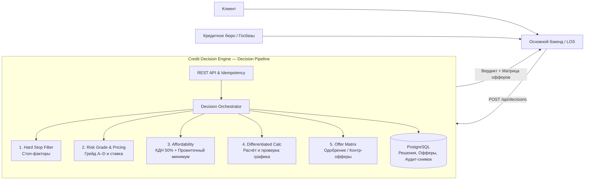

# Credit Decision Platform — технический дизайн

**Версия документа:** 3.0.
**Целевая версия системы:** v1.
**Дата:** 19 октября 2026.

## 1. Назначение документа

Документ определяет архитектуру, границы ответственности, конвейер принятия решений (Decision Pipeline), финансовую и скоринговую модель, API, схему хранения и эксплуатационные требования сервиса **Credit Decision Engine** (Credit Decision Platform).

Последовательность реализации и критерии готовности приведены в [плане разработки](development-plan.md). Инструкции по локальному запуску и текущему состоянию кода описаны в [README](../README.md).

---

## 2. Роль сервиса в общей системе и границы продукта

Сервис является **специализированным движком принятия кредитных решений (Decision Engine)** внутри распределённого FinTech-ландшафта. Он не взаимодействует напрямую с заёмщиком и не обращается напрямую в государственные базы данных или внешние кредитные бюро (БКИ).

Сервис вызывается доверенным **основным бэкендом** (Loan Origination System / Core Banking / BFF):
- Основной бэкенд ведёт общий жизненный цикл клиентской заявки, взаимодействует с мобильным приложением/веб-интерфейсом, запрашивает кредитные бюро и агрегирует финансовый и демографический профиль заёмщика.
- Наш сервис принимает нормализованный профиль, прогоняет его через 5-ступенчатый конвейер принятия решений (стоп-факторы $\to$ риск-грейд и ценообразование $\to$ расчёт платёжеспособности с учётом КДН и прожиточного минимума $\to$ математика дифференцированного графика $\to$ генерация офферов), формирует вердикт (`APPROVED`, `COUNTER_OFFER`, `REJECTED`) и сохраняет полный аудиторский снимок в PostgreSQL.



### Входит в границы v1:
- Синхронный приём запроса на принятие кредитного решения от основного бэка (`POST /api/decisions`) с защитой идемпотентности (`requestId`).
- **Этап 1 (Knock-out / Hard Stop Filter):** отсечение по жёстким стоп-факторам (возраст заёмщика на момент подачи и погашения, наличие активной просрочки, глубокая историческая просрочка 90+ дней / NPL, критически низкий `creditScore`).
- **Этап 2 (Risk-Based Pricing & Risk Grading):** присвоение риск-грейда (`A`, `B`, `C`, `D`, `REJECT`) по шкале `creditScore` ($300–850$), автоматическое назначение индивидуальной годовой процентной ставки (APR) и максимального лимита риска на заёмщика (Risk Exposure Cap).
- **Этап 3 (Affordability / Оценка платёжеспособности):** двойной контроль доступного ежемесячного бюджета — одновременно по коэффициенту долговой нагрузки ($\text{DTI} \le 50\%$) и по остатку дохода не ниже прожиточного минимума ($\text{Subsistence Minimum}$).
- **Этап 4 (Differentiated Loan Calculator):** расчёт дифференцированного графика платежей (равномерное погашение основного долга + проценты на остаток), обратный расчёт максимальной доступной суммы с округлением вниз до кредитного шага (`10 000 KZT`) и контрольной верификацией по реальному графику.
- **Этап 5 (Smart Offer Generation):** формирование исхода `APPROVED`, `COUNTER_OFFER` или `REJECTED`. При `COUNTER_OFFER` формируется матрица альтернативных вариантов:
  - *Вариант А (снижение суммы):* максимально доступная сумма на запрошенном сроке;
  - *Вариант Б (увеличение срока):* одобрение запрошенной (или большей) суммы за счёт удлинения срока кредита в пределах продуктового и возрастного лимитов.
- Сохранение полного неизменяемого снимка (входные данные, версия политики, сработавшие правила, грейд, расчётные показатели, предложенные офферы) в PostgreSQL.
- Чтение решения по ID и пагинированная история решений.

### Не входит в границы сервиса:
- Взаимодействие с конечным пользователем, UI, согласование и подписание договора.
- Прямые сетевые вызовы в БКИ, государственные базы, KYC/AML-сервисы.
- Ведение счетов, бухгалтерские проводки, фактическая выдача средств и обслуживание графика погашения.
- Аннуитетные платежи, плавающие ставки, комиссии и страховые премии.

---

## 3. Конвейер принятия решений (Decision Pipeline) и бизнес-логика

### 3.1. Входной профиль (`DecisionRequest`)
Основной бэкенд передаёт:
1. `requestId` (UUID) — уникальный идентификатор запроса из основной системы (ключ идемпотентности).
2. `applicantAgeYears` (Integer) — полный возраст заёмщика в годах на момент подачи заявки.
3. `monthlyIncome` (BigDecimal > 0) — подтверждённый среднемесячный чистый доход (после вычета налогов, в KZT).
4. `existingMonthlyPayments` (BigDecimal >= 0) — сумма ежемесячных платежей по всем действующим кредитам из БКИ.
5. `creditScore` (Integer, $300–850$) — внешний скоринговый балл из кредитного бюро.
6. `hasActiveDelinquency` (Boolean) — наличие текущей открытой просрочки по действующим обязательствам.
7. `maxDelinquencyDaysLast12Months` (Integer >= 0) — максимальная глубина просрочки в днях за последние 12 месяцев.
8. `requestedAmount` (BigDecimal > 0) — запрашиваемая сумма кредита (в KZT).
9. `requestedTermMonths` (Integer) — запрашиваемый срок кредита в месяцах.

*(Ошибки формата, отрицательные суммы или выход `creditScore` за пределы технической шкалы $300–850$ отклоняются на уровне HTTP валидации с кодом `400 Bad Request`, не создавая кредитного отказа).*

---

### 3.2. Параметры кредитной политики (`CreditPolicy v1-commercial-2026`)

| Параметр | Значение по умолчанию | Описание |
|---|---|---|
| `minProductAmount` | `100 000.00 KZT` | Минимальная сумма выдаваемого кредита |
| `maxProductAmount` | `10 000 000.00 KZT` | Максимальная сумма кредита по продукту |
| `amountStep` | `10 000.00 KZT` | Шаг округления суммы кредитного предложения (вниз) |
| `minTermMonths` / `maxTermMonths` | `6` / `60` мес. | Допустимый диапазон срока кредита |
| `candidateTerms` | `[6, 12, 18, 24, 36, 48, 60]` | Стандартная сетка сроков для подбора альтернативного контр-оффера |
| `minAgeAtApplication` | `21` год | Минимальный возраст на момент подачи |
| `maxAgeAtMaturity` | `65` лет | Максимальный возраст на момент планового погашения кредита |
| `maxAllowedDelinquencyDays` | `30` дней | Допустимый максимум исторической просрочки за 12 мес. |
| `minCreditScore` | `520` | Минимальный проходной кредитный балл |
| `maxDtiRatio` | `0.50` (50%) | Максимальный коэффициент долговой нагрузки (КДН) |
| `subsistenceMinimum` | `85 000.00 KZT` | Неснижаемый прожиточный минимум, остающийся после всех платежей |

---

### 3.3. Стадия 1: Стоп-факторы (Hard Stop / Knock-out Rules)

На первой стадии проверяются жёсткие правила отсечения. Все правила вычисляются полностью, чтобы вернуть исчерпывающий список причин отказа:

| Код правила / причины | Условие срабатывания отказа (`REJECTED`) |
|---|---|
| `APPLICANT_TOO_YOUNG` | `applicantAgeYears < 21` |
| `AGE_AT_MATURITY_EXCEEDED` | $\text{applicantAgeYears} + \lceil \text{requestedTermMonths} / 12.0 \rceil > 65$ (если даже минимальный срок 6 мес. превышает 65 лет — полный отказ; если превышает только запрошенный срок — ограничение максимального срока на стадии оффера) |
| `ACTIVE_DELINQUENCY_PRESENT` | `hasActiveDelinquency == true` |
| `SEVERE_HISTORICAL_DELINQUENCY` | `maxDelinquencyDaysLast12Months > 30` |
| `CREDIT_SCORE_BELOW_MINIMUM` | `creditScore < 520` |

Если сработал хотя бы один безусловный стоп-фактор, конвейер немедленно завершается со статусом `REJECTED` и списком кодов причин.

---

### 3.4. Стадия 2: Риск-грейд и ценообразование (Risk-Based Pricing)

По значению `creditScore` определяется риск-грейд заёмщика (`RiskGrade`), который задаёт индивидуальную номинальную годовую процентную ставку (`nominalAnnualRate`) и максимальный лимит риска на заёмщика (`riskExposureCap`):

| Диапазон `creditScore` | Risk Grade | Годовая ставка (`nominalAnnualRate`) | Лимит суммы по риску (`riskExposureCap`) |
|---|---|---|---|
| `750 – 850` | `GRADE_A` (Prime) | `0.1600` (16.0% годовых) | `10 000 000.00 KZT` |
| `680 – 749` | `GRADE_B` (Near-Prime) | `0.2000` (20.0% годовых) | `6 000 000.00 KZT` |
| `600 – 679` | `GRADE_C` (Standard) | `0.2500` (25.0% годовых) | `3 000 000.00 KZT` |
| `520 – 599` | `GRADE_D` (Subprime) | `0.3200` (32.0% годовых) | `1 000 000.00 KZT` |
| `< 520` | `REJECT` | — | `0.00 KZT` |

---

### 3.5. Стадия 3: Расчёт платёжеспособности (Affordability: КДН + Прожиточный минимум)

Доступный ежемесячный бюджет на обслуживание нового кредита ограничивается двумя независимыми величинами:

1. **Бюджет по нормативу КДН (DTI Limit):**
   $$\text{Budget}_{\text{DTI}} = \text{monthlyIncome} \times \text{maxDtiRatio} - \text{existingMonthlyPayments}$$
2. **Бюджет по располагаемому доходу (Subsistence Limit):**
   $$\text{Budget}_{\text{Subsistence}} = \text{monthlyIncome} - \text{subsistenceMinimum} - \text{existingMonthlyPayments}$$
3. **Итоговый доступный бюджет нового ежемесячного платежа:**
   $$\text{AvailablePaymentBudget} = \min(\text{Budget}_{\text{DTI}}, \text{Budget}_{\text{Subsistence}})$$

- Если $\text{Budget}_{\text{DTI}} \le 0$ $\to$ отказ с кодом `DTI_LIMIT_EXCEEDED`.
- Если $\text{Budget}_{\text{Subsistence}} \le 0$ $\to$ отказ с кодом `INSUFFICIENT_DISPOSABLE_INCOME`.

---

### 3.6. Стадия 4: Финансовый калькулятор дифференцированного кредита

Для дифференцированного кредита со сроком $N$ месяцев и годовой ставкой $R$:
1. **Месячная ставка:** $r = \frac{R}{12}$ (промежуточные деления выполняются с точностью `DECIMAL128`, денежные величины округляются до 2 знаков по `RoundingMode.HALF_EVEN`).
2. **Погашение основного долга в месяц ($i = 1 \dots N-1$):**
   $$P_{\text{principal}} = \text{round}\left(\frac{S}{N}, 2, \text{HALF\_EVEN}\right)$$
   В последний месяц ($i = N$) погашается точный остаток:
   $$P_{\text{principal}, N} = S - P_{\text{principal}} \times (N - 1)$$
3. **Проценты за месяц $i$:**
   $$I_i = \text{round}(S_{\text{rem}, i} \times r, 2, \text{HALF\_EVEN})$$
   где $S_{\text{rem}, i}$ — остаток основного долга на начало месяца $i$.
4. **Ежемесячный платёж:** $\text{Payment}_i = P_{\text{principal}, i} + I_i$.
5. **Максимальный платёж графика:** достигается в 1-й месяц ($i = 1$):
   $$\text{FirstMonthlyPayment}(S, N, R) = P_{\text{principal}, 1} + \text{round}(S \times r, 2, \text{HALF\_EVEN})$$

#### Обратный расчёт максимальной доступной суммы $S_{\max}(N, R)$:
1. Теоретическая верхняя граница по формуле:
   $$S_{\text{raw}} = \frac{\text{AvailablePaymentBudget}}{\frac{1}{N} + \frac{R}{12}}$$
2. Применение потолков риска и продукта:
   $$S_{\text{capped}} = \min(S_{\text{raw}}, \text{riskExposureCap}, \text{maxProductAmount})$$
3. Округление **вниз** (`RoundingMode.FLOOR`) до шага кредитования `amountStep` (`10 000 KZT`):
   $$S_{\text{candidate}} = \left\lfloor \frac{S_{\text{capped}}}{\text{amountStep}} \right\rfloor \times \text{amountStep}$$
4. **Точная верификация графиком:** строится реальный помесячный график для $S_{\text{candidate}}$. Если из-за копеечного округления $\text{FirstMonthlyPayment}(S_{\text{candidate}}) > \text{AvailablePaymentBudget}$, сумма уменьшается на один шаг `amountStep` (`10 000 KZT`).

---

### 3.7. Стадия 5: Генерация решения и матрица контр-офферов (Offer Generator)

Определяется максимально допустимый срок для заёмщика с учётом возраста погашения:
$$\text{MaxAllowedTermByAge} = \min\big(\text{maxTermMonths}, (65 - \text{applicantAgeYears}) \times 12\big)$$

1. **Проверка запрошенных условий (`requestedAmount`, `requestedTermMonths`):**
   - Если `requestedTermMonths <= MaxAllowedTermByAge`, `requestedAmount <= riskExposureCap`, `requestedAmount <= maxProductAmount` и для запрошенной суммы $\text{FirstMonthlyPayment}(\text{requestedAmount}, \text{requestedTermMonths}, R) \le \text{AvailablePaymentBudget}$:
   - Вердикт: **`APPROVED`**. Формируется один утверждённый оффер на точную запрошенную сумму и запрошенный срок. Причина: `APPROVED_AS_REQUESTED`.

2. **Если запрошенные условия не проходят — поиск контр-офферов (`COUNTER_OFFER`):**
   Сервис формирует до двух коммерческих вариантов (`LoanOffer`):
   - **Оффер 1 (`REDUCED_AMOUNT_SAME_TERM`):** если запрошенный срок допустим по возрасту, рассчитывается максимальная сумма $S_{\max}(\text{requestedTermMonths}, R)$. Если $S_{\max} \ge \text{minProductAmount}$, оффер добавляется в список предложений.
   - **Оффер 2 (`EXTENDED_TERM_FOR_AMOUNT`):** если запрошенная сумма не поместилась по ежемесячному платежу, сервис перебирает стандартные сроки из сетки `candidateTerms` (`> requestedTermMonths` и `<= MaxAllowedTermByAge`). Выбирается минимальный увеличенный срок, на котором можно одобрить полную `requestedAmount` (либо, если упёрлись в ` MaxAllowedTermByAge`, максимальную сумму на предельном сроке, если она больше суммы Оффера 1).

3. **Итоговая развилка для контр-оффера и отказа:**
   - Если сформирован хотя бы один валидный оффер с суммой $\ge \text{minProductAmount}$ $\to$ статус **`COUNTER_OFFER`** с кодами причин ограничения (`PAYMENT_CAPACITY_LIMITED_ON_REQUESTED_TERM`, `RISK_GRADE_CAP_APPLIED`, `TERM_REDUCED_BY_MATURITY_AGE`).
   - Если ни на запрошенном, ни на увеличенном сроке доступная сумма не достигает `minProductAmount` (`100 000 KZT`) $\to$ статус **`REJECTED`** с причиной `CAPACITY_BELOW_MIN_PRODUCT_AMOUNT`.

---

## 4. Архитектура пакетов и компонентов

```text
kz.alitulegenov.creditdecisionengine
├── controller               # REST API (/api/decisions)
├── dto                      # Request/Response DTO, ApiError
├── service                  # Сервисный слой, идемпотентность, транзакции
├── domain                   # Чистое ядро бизнес-логики (без зависимостей на Spring/JPA)
│   ├── model                # DecisionInput, DecisionEvaluation, LoanOffer, PaymentSchedule
│   ├── policy               # CreditPolicy, RiskGrade, параметры и пороги
│   ├── rule                 # HardStopEvaluator и правила отсечения (Specification)
│   ├── pricing              # RiskGradeResolver (Risk-Based Pricing)
│   ├── affordability        # AffordabilityCalculator (DTI + Subsistence Minimum)
│   ├── calculator           # DifferentiatedLoanCalculator (график и обратный расчёт)
│   └── offer                # OfferMatrixGenerator и DecisionPipeline
├── entity                   # JPA-сущности
├── repository               # Spring Data JPA репозитории
└── exception                # Исключения и GlobalExceptionHandler
```

---

## 5. Схема хранения в PostgreSQL (Flyway V4)

Существующие применённые миграции `V1`–`V3` не редактируются для сохранения контрольных сумм Flyway. Миграция `V4__replace_loan_decision_with_credit_decision.sql` удаляет устаревшую учебную таблицу `loan_decision` и создаёт актуальную таблицу `credit_decision`:

| Колонка | Тип PostgreSQL | Ограничения | Назначение |
|---|---|---|---|
| `id` | `UUID` | `PRIMARY KEY` | Внутренний ID решения |
| `request_id` | `UUID` | `NOT NULL UNIQUE` | Внешний ID запроса от основного бэка (идемпотентность) |
| `status` | `VARCHAR(32)` | `NOT NULL` | `APPROVED`, `COUNTER_OFFER`, `REJECTED` |
| `policy_version` | `VARCHAR(64)` | `NOT NULL` | Версия политики (`v1-commercial-2026`) |
| `applicant_age_years` | `INT` | `NOT NULL` | Возраст заёмщика (снимок входа) |
| `monthly_income` | `NUMERIC(19,2)` | `NOT NULL` | Чистый ежемесячный доход |
| `existing_monthly_payments` | `NUMERIC(19,2)` | `NOT NULL` | Действующие ежемесячные платежи |
| `credit_score` | `INT` | `NOT NULL` | Внешний балл из БКИ ($300–850$) |
| `has_active_delinquency` | `BOOLEAN` | `NOT NULL` | Флаг активной просрочки |
| `max_delinquency_days_12m` | `INT` | `NOT NULL` | Макс. дней просрочки за 12 мес. |
| `requested_amount` | `NUMERIC(19,2)` | `NOT NULL` | Запрошенная сумма |
| `requested_term_months` | `INT` | `NOT NULL` | Запрошенный срок в месяцах |
| `risk_grade` | `VARCHAR(16)` | `NULL` | Присвоенный грейд (`GRADE_A`..`GRADE_D`, `REJECT`) |
| `assigned_annual_rate` | `NUMERIC(7,4)` | `NULL` | Назначенная годовая ставка |
| `risk_exposure_cap` | `NUMERIC(19,2)` | `NULL` | Лимит суммы по риск-грейду |
| `available_payment_budget` | `NUMERIC(19,2)` | `NULL` | Доступный ежемесячный бюджет платежа |
| `current_dti_ratio` | `NUMERIC(7,4)` | `NULL` | Текущий КДН до нового кредита |
| `reason_codes` | `JSONB` | `NOT NULL` | Массив кодов причин решения |
| `offers` | `JSONB` | `NOT NULL` | Массив сформированных предложений (`LoanOffer`) |
| `created_at` | `TIMESTAMPTZ` | `NOT NULL` | Дата и время расчёта (UTC) |

Индексы:
- `uk_credit_decision_request_id` на `(request_id)` для мгновенной проверки идемпотентности и защиты от дублей на уровне СУБД.
- `idx_credit_decision_created_at_id` на `(created_at DESC, id DESC)` для стабильной пагинации истории.

---

## 6. Контракт REST API

### 6.1. `POST /api/decisions` — Принятие кредитного решения

**Запрос:**
```json
{
  "requestId": "9c8661a7-bfca-4e92-a5d6-e83946092775",
  "applicantAgeYears": 32,
  "monthlyIncome": 450000.00,
  "existingMonthlyPayments": 80000.00,
  "creditScore": 710,
  "hasActiveDelinquency": false,
  "maxDelinquencyDaysLast12Months": 0,
  "requestedAmount": 3000000.00,
  "requestedTermMonths": 12
}
```

**Ответ при `COUNTER_OFFER` (`200 OK`):**
*(Заёмщик получил `GRADE_B` со ставкой 20% и лимитом 6 млн ₸. Доступный бюджет платежа: $\min(450\,000 \times 0.50 - 80\,000,\; 450\,000 - 85\,000 - 80\,000) = 145\,000\text{ ₸}$. На 12 месяцев 3 млн ₸ требуют первого платежа $300\,000\text{ ₸}$, что больше бюджета. Движок предлагает два варианта: уменьшить сумму на 12 мес. до 1.44 млн ₸ ИЛИ взять полные 3 млн ₸ на 36 мес.)*

```json
{
  "decisionId": "b2c3d4e5-f6a7-8901-bcde-f12345678901",
  "requestId": "9c8661a7-bfca-4e92-a5d6-e83946092775",
  "status": "COUNTER_OFFER",
  "policyVersion": "v1-commercial-2026",
  "riskAssessment": {
    "creditScore": 710,
    "riskGrade": "GRADE_B",
    "assignedNominalAnnualRate": 0.2000,
    "riskExposureCap": 6000000.00
  },
  "affordability": {
    "monthlyIncome": 450000.00,
    "existingMonthlyPayments": 80000.00,
    "currentDtiRatio": 0.1778,
    "availableMonthlyBudget": 145000.00
  },
  "reasonCodes": [
    "PAYMENT_CAPACITY_LIMITED_ON_REQUESTED_TERM"
  ],
  "offers": [
    {
      "offerType": "REDUCED_AMOUNT_SAME_TERM",
      "principalAmount": 1440000.00,
      "termMonths": 12,
      "nominalAnnualRate": 0.2000,
      "firstMonthlyPayment": 144000.00,
      "lastMonthlyPayment": 122000.00,
      "totalInterestAmount": 156000.00,
      "totalPayableAmount": 1596000.00,
      "projectedMaxDtiRatio": 0.4978
    },
    {
      "offerType": "EXTENDED_TERM_FOR_AMOUNT",
      "principalAmount": 3000000.00,
      "termMonths": 36,
      "nominalAnnualRate": 0.2000,
      "firstMonthlyPayment": 133333.33,
      "lastMonthlyPayment": 84722.25,
      "totalInterestAmount": 925000.00,
      "totalPayableAmount": 3925000.00,
      "projectedMaxDtiRatio": 0.4741
    }
  ],
  "createdAt": "2026-10-19T11:30:00Z"
}
```

### 6.2. `GET /api/decisions/{id}` и `GET /api/decisions`
- Чтение сохранённого решения по `decisionId` (`200 OK` или `404 Not Found`).
- Пагинированный список решений (`page`, `size`, сортировка `createdAt DESC, id DESC`).

---

## 7. Архитектурные решения (ADR)

| ID | Решение | Обоснование |
|---|---|---|
| **ADR-001** | **Сервис как внутренний Decision Engine** | Разделение ответственности: LOS отвечает за сбор данных из БКИ и работу с клиентом, а наш сервис — за чистую детерминированную математику, риск-политику и воспроизводимость решений. |
| **ADR-002** | **Risk-Based Pricing вместо внешней ставки** | В коммерческом кредитовании процентная ставка является функцией риска заёмщика. Назначение ставки через `RiskGrade` внутри движка делает бизнес-логику целостной и реалистичной. |
| **ADR-003** | **Двойной критерий платёжеспособности (КДН + Прожиточный минимум)** | Защищает заёмщиков с невысоким доходом от ситуации, когда 50% дохода формально свободны, но оставшейся суммы недостаточно для базовых расходов. |
| **ADR-004** | **Округление суммы до шага и проверка реальным графиком** | Исключает расхождение между аналитической формулой и фактическим помесячным графиком с округлением `HALF_EVEN`. |
| **ADR-005** | **Матрица контр-офферов (сумма vs срок)** | Повышает конверсию в реальном бизнесе: клиенту, которому важна вся сумма, предлагается более длинный срок, а клиенту, которому важен короткий срок — доступная сумма. |
