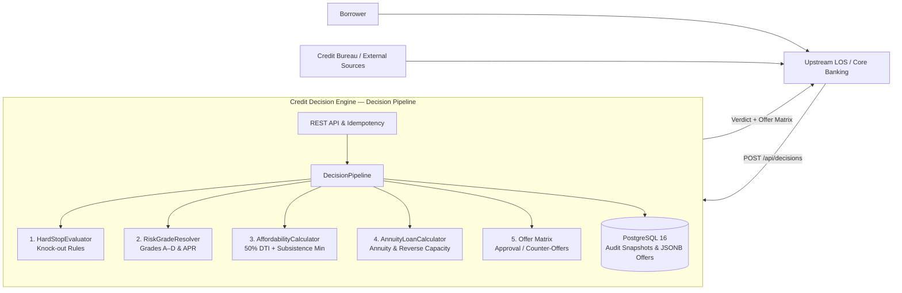

# Credit Decision Engine — Technical Design

**Document Version:** 3.1
**Status:** Implemented

## 1. Purpose

This document specifies the system boundaries, 5-stage Decision Pipeline, annuity financial mathematics, risk-based pricing tiers, REST API contracts, and PostgreSQL persistence schema for the **Credit Decision Engine**.

---

## 2. System Boundaries & Role

The service acts as a dedicated **Credit Decision Engine** within a distributed FinTech architecture. It does not interact directly with end-user borrowers or external credit bureau networks over the internet.

Instead, it is invoked by a trusted upstream **Loan Origination System (LOS / Core Banking / BFF)**:
- The upstream LOS manages the customer-facing application lifecycle, identity verification (KYC), and credit bureau data aggregation.
- Our service receives the normalized borrower profile, runs a deterministic 5-stage decision pipeline (Hard-Stop Screening $\to$ Risk-Based Pricing $\to$ Dual-Constraint Affordability $\to$ Annuity Schedule & Reverse Capacity Math $\to$ Smart Offer Matrix Generation), returns the final decision (`APPROVED`, `COUNTER_OFFER`, or `REJECTED`), and records an immutable audit snapshot in its own dedicated PostgreSQL database (`Database per Service`).



---

## 3. Decision Pipeline & Business Logic

### 3.1. Inbound Profile (`CreditDecisionRequest` / `DecisionInput`)
1. `requestId` (`UUID`) — unique request identifier from the upstream system used for idempotency.
2. `applicantAgeYears` (`Integer`, $18–100$) — applicant's full age in years at application time.
3. `monthlyIncome` (`BigDecimal > 0`) — verified net monthly income after taxes (in KZT).
4. `existingMonthlyPayments` (`BigDecimal >= 0`) — total monthly debt payments across all active loans reported by the credit bureau.
5. `creditScore` (`Integer`, $300–850$) — external credit bureau score.
6. `hasActiveDelinquency` (`Boolean`) — whether the applicant currently has an active overdue obligation.
7. `maxDelinquencyDaysLast12Months` (`Integer >= 0`) — worst delinquency duration in days over the past 12 months.
8. `requestedAmount` (`BigDecimal > 0`) — requested loan principal (in KZT).
9. `requestedTermMonths` (`Integer`, $6–60$) — requested loan duration in months.

---

### 3.2. Credit Policy Parameters (`CreditPolicy`)

| Parameter | Default Value | Description |
|---|---|---|
| `minProductAmount` | `100,000.00 KZT` | Minimum loan principal issued by the product |
| `maxProductAmount` | `10,000,000.00 KZT` | Maximum loan principal issued for an unsecured loan |
| `amountStep` | `10,000.00 KZT` | Downward rounding step for counter-offer principal amounts |
| `minTermMonths` / `maxTermMonths` | `6` / `60` months | Supported loan duration boundaries |
| `candidateTerms` | `[6, 12, 18, 24, 36, 48, 60]` | Standard term grid used when searching for extended-term counter-offers |
| `minAgeAtApplication` | `21` years | Minimum eligible borrower age at application |
| `maxAgeAtMaturity` | `65` years | Maximum eligible borrower age at loan maturity |
| `maxAllowedDelinquencyDays` | `30` days | Maximum tolerated historical delinquency over the last 12 months |
| `minCreditScore` | `520` | Minimum external credit score required to pass hard-stop screening |
| `maxDtiRatio` | `0.50` (50%) | Maximum allowed Debt-to-Income (DTI) ratio |
| `subsistenceMinimum` | `85,000.00 KZT` | Statutory monthly living allowance that must remain after all debt payments |

---

### 3.3. Stage 1: Hard-Stop / Knock-Out Rules (`HardStopEvaluator`)

All knock-out rules are evaluated exhaustively so that every applicable rejection reason is captured in the audit snapshot:

| Reason Code | Trigger Condition (`REJECTED`) |
|---|---|
| `APPLICANT_TOO_YOUNG` | `applicantAgeYears < 21` |
| `AGE_AT_MATURITY_EXCEEDED` | $\text{applicantAgeYears} + \lceil \text{minTermMonths} / 12.0 \rceil > 65$ |
| `ACTIVE_DELINQUENCY_PRESENT` | `hasActiveDelinquency == true` |
| `SEVERE_HISTORICAL_DELINQUENCY` | `maxDelinquencyDaysLast12Months > 30` |
| `CREDIT_SCORE_BELOW_MINIMUM` | `creditScore < 520` |

---

### 3.4. Stage 2: Risk-Based Pricing (`RiskGradeResolver`)

The external `creditScore` maps the applicant to an internal `RiskGrade`, assigning both an individualized nominal annual interest rate (`nominalAnnualRate`) and a maximum principal exposure limit (`riskExposureCap`):

| `creditScore` Range | Risk Grade | Nominal Annual Rate (`APR`) | Risk Exposure Cap (`riskExposureCap`) |
|---|---|---|---|
| `750 – 850` | `GRADE_A` (Prime) | `0.1600` (16.0%) | `10,000,000.00 KZT` |
| `680 – 749` | `GRADE_B` (Near-Prime) | `0.2000` (20.0%) | `6,000,000.00 KZT` |
| `600 – 679` | `GRADE_C` (Standard) | `0.2500` (25.0%) | `3,000,000.00 KZT` |
| `520 – 599` | `GRADE_D` (Subprime) | `0.3200` (32.0%) | `1,000,000.00 KZT` |
| `< 520` | `REJECT` | `0.0000` | `0.00 KZT` |

---

### 3.5. Stage 3: Dual-Constraint Affordability (`AffordabilityCalculator`)

The borrower's available monthly budget for a new loan is constrained by the stricter of two regulatory and solvency limits:

1. **Debt-to-Income (DTI) Ceiling:**
   $$\text{Budget}_{\text{DTI}} = \text{monthlyIncome} \times 0.50 - \text{existingMonthlyPayments}$$
2. **Subsistence Minimum Protection:**
   $$\text{Budget}_{\text{Subsistence}} = \text{monthlyIncome} - 85\,000 - \text{existingMonthlyPayments}$$
3. **Effective Monthly Payment Budget:**
   $$\text{AvailableMonthlyBudget} = \max\big(0,\; \min(\text{Budget}_{\text{DTI}}, \text{Budget}_{\text{Subsistence}})\big)$$

---

### 3.6. Stage 4: Annuity Loan Calculator (`AnnuityLoanCalculator`)

For an annuity loan of term $N$ months and nominal annual interest rate $R$:
1. **Monthly Interest Rate:** $r = \frac{R}{12}$ (computed using `MathContext.DECIMAL128`).
2. **Annuity Factor:**
   $$K = \frac{r \times (1 + r)^N}{(1 + r)^N - 1}$$
3. **Fixed Monthly Installment** (rounded to 2 decimal places using `RoundingMode.HALF_EVEN`):
   $$\text{PMT} = \text{round}(S \times K, 2)$$
4. **Reverse Maximum Affordable Principal $S_{\max}(N, R)$:**
   - Theoretical upper bound: $S_{\text{raw}} = \lfloor \text{AvailableMonthlyBudget} / K \rfloor$.
   - Cap by risk grade and product maximum: $S_{\text{capped}} = \min(S_{\text{raw}}, \text{riskExposureCap}, \text{maxProductAmount})$.
   - Round strictly down (`RoundingMode.FLOOR`) to the `10,000 KZT` step and verify via `calculateSchedule(...)` that the resulting installment fits within `AvailableMonthlyBudget`.

---

### 3.7. Stage 5: Verdict & Counter-Offer Matrix (`DecisionPipeline`)

1. **Direct Approval (`APPROVED`):** If the requested term satisfies the maturity age limit ($\le 65$ years), the requested amount is within risk/product caps, and the monthly payment fits `AvailableMonthlyBudget`, a single `REQUESTED_TERMS` offer is returned.
2. **Counter-Offer Matrix (`COUNTER_OFFER`):** Otherwise, up to two alternative commercial offers are generated:
   - **Option A (`REDUCED_AMOUNT_SAME_TERM`):** maximum affordable principal on the requested (or maturity-capped) term.
   - **Option B (`EXTENDED_TERM_FOR_AMOUNT`):** shortest extended term from `candidateTerms` (`[6, 12, 18, 24, 36, 48, 60]`) that allows the borrower to qualify for the full requested amount (or effective cap).
3. **Rejection (`REJECTED`):** If no offer reaches `minProductAmount` (`100,000 KZT`), the request is rejected with `CAPACITY_BELOW_MIN_PRODUCT_AMOUNT`.

---

## 4. Package Structure

```text
kz.alitulegenov.creditdecisionengine
├── controller               # CreditDecisionController (/api/decisions)
├── dto                      # CreditDecisionRequest, CreditDecisionResponse, CreditDecisionPageResponse, ApiError
├── service                  # CreditDecisionService (idempotency and transactional persistence)
├── domain                   # Pure domain core (framework-independent business logic)
│   ├── model                # DecisionInput, DecisionResult, DecisionStatus, DecisionReasonCode, LoanOffer, OfferType
│   ├── policy               # CreditPolicy, RiskGrade
│   ├── rule                 # HardStopEvaluator
│   ├── pricing              # RiskGradeResolver
│   ├── affordability        # AffordabilityCalculator
│   ├── calculator           # AnnuityLoanCalculator
│   └── offer                # DecisionPipeline
├── entity                   # CreditDecision (immutable JPA entity with JSONB columns)
├── repository               # CreditDecisionRepository
└── exception                # CreditDecisionNotFoundException, GlobalExceptionHandler
```

---

## 5. REST API Contract (`/api/decisions`)

### `POST /api/decisions` — Evaluate Credit Decision

**Request:**
```json
{
  "requestId": "11111111-2222-3333-4444-555555555502",
  "applicantAgeYears": 32,
  "monthlyIncome": 450000.00,
  "existingMonthlyPayments": 80000.00,
  "creditScore": 710,
  "hasActiveDelinquency": false,
  "maxDelinquencyDaysLast12Months": 0,
  "requestedAmount": 3000000.00,
  "requestedTermMonths": 12
}
```

**Response (`200 OK`, `COUNTER_OFFER`):**
```json
{
  "id": "b2c3d4e5-f6a7-8901-bcde-f12345678901",
  "requestId": "11111111-2222-3333-4444-555555555502",
  "status": "COUNTER_OFFER",
  "applicantAgeYears": 32,
  "monthlyIncome": 450000.00,
  "existingMonthlyPayments": 80000.00,
  "creditScore": 710,
  "hasActiveDelinquency": false,
  "maxDelinquencyDaysLast12Months": 0,
  "requestedAmount": 3000000.00,
  "requestedTermMonths": 12,
  "riskGrade": "GRADE_B",
  "assignedAnnualRate": 0.2000,
  "riskExposureCap": 6000000.00,
  "currentDtiRatio": 0.1778,
  "availableMonthlyBudget": 145000.00,
  "reasonCodes": [
    "PAYMENT_CAPACITY_LIMITED_ON_REQUESTED_TERM"
  ],
  "offers": [
    {
      "offerType": "REDUCED_AMOUNT_SAME_TERM",
      "principalAmount": 1560000.00,
      "termMonths": 12,
      "nominalAnnualRate": 0.2000,
      "monthlyPayment": 144509.83,
      "totalInterestAmount": 174117.96,
      "totalPayableAmount": 1734117.96,
      "projectedDtiRatio": 0.4989
    },
    {
      "offerType": "EXTENDED_TERM_FOR_AMOUNT",
      "principalAmount": 3000000.00,
      "termMonths": 36,
      "nominalAnnualRate": 0.2000,
      "monthlyPayment": 111490.75,
      "totalInterestAmount": 1013667.00,
      "totalPayableAmount": 4013667.00,
      "projectedDtiRatio": 0.4255
    }
  ],
  "createdAt": "2026-10-19T14:30:00Z"
}
```
