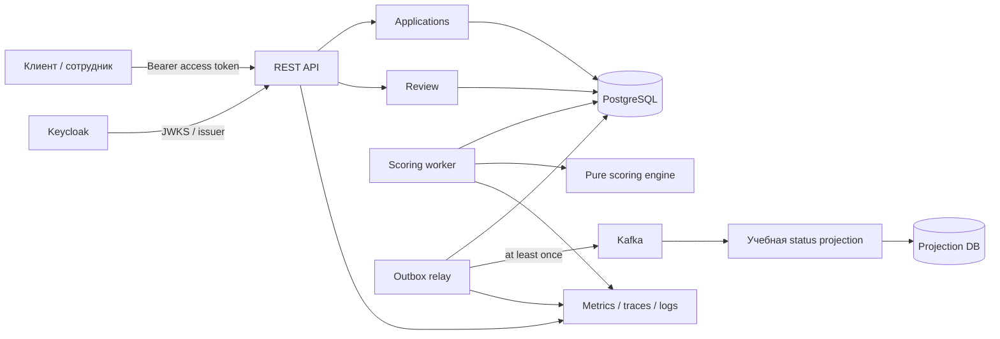
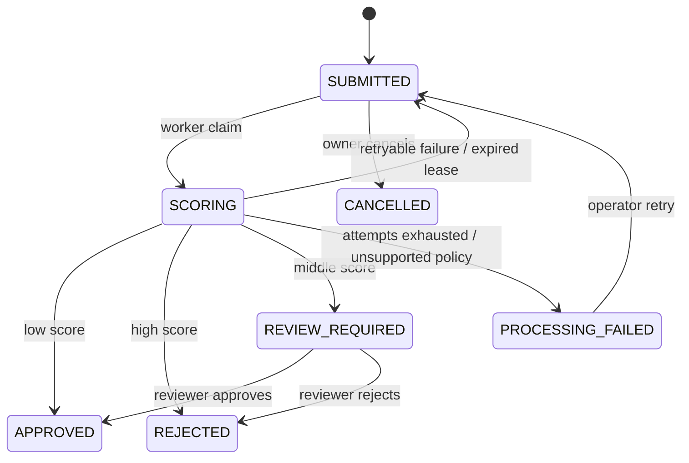

# Credit Decision Platform — дизайн целевой системы

**Статус:** проект v1.0 для обсуждения, не утверждён.  
**Дата:** 15 октября 2026, Asia/Almaty.  
**Проект:** Credit Decision Platform; исходное имя приложения — Credit Decision Engine.  
**Исходный снимок кода для проектирования:** `91f3136165374f2be709290cb8717309e70b71dc`.  
**Назначение:** учебная FinTech-система кредитного скоринга и обработки заявок с проверяемой надёжностью. Это проект архитектуры, а не подтверждение пригодности для реального банковского кредитования.

## 1. Как читать документ

«Текущее состояние» подтверждено чтением исходников. «Целевое решение» — предложение автора на согласование. Числа для нагрузки, таймаутов, сроков хранения и продуктовых лимитов — проектные допущения, не банковские нормативы. Технические источники приведены в разделе 23.

Сначала согласовываем продукт и основные решения, затем реализуем по одному небольшому шагу. Документ описывает целевую систему; актуальные возможности и инструкции запуска находятся в [README](../README.md), последовательность реализации — в [плане разработки](development-plan.md). Публикация дизайна в репозитории не означает, что все предлагаемые функции уже реализованы или все продуктовые допущения утверждены.

## 2. Исходное состояние на момент проектирования

Этот раздел сохраняет исторический снимок на указанном выше коммите. После аудита добавлены README, внешняя конфигурация, улучшенный Compose и базовый CI; сборка и 14 существующих тестов проверены локально на отдельном PostgreSQL. Текущие инструкции находятся в [README](../README.md).

| Область | Подтверждённое состояние |
|---|---|
| Платформа | Java 21; Spring Boot **4.1.1** в `pom.xml`, Maven Wrapper 3.9.16 |
| HTTP | `POST /api/decisions` синхронно рассчитывает и сохраняет решение, обычный ответ 200; GET по UUID; GET списка |
| Вход | `income`, `requestedAmount`: положительные BigDecimal, до 17 целых и 2 дробных знаков; `termMonths`: 1–360 |
| Скоринг | +40 при сумме > 10 доходов; +20 при сроке > 36; +30 при доходе < 300000; одобрение при score < 50 |
| Данные | Одна сущность `LoanDecision`: UUID, входные значения, score, approved, createdAt; отдельной заявки нет |
| Хранение | PostgreSQL 16 Alpine в Compose; JPA; миграции Flyway V1–V3 |
| История | page=0, size=20 по умолчанию; size 1–100; `createdAt DESC, id DESC`; соответствующий индекс V3 |
| Ошибки | Собственный `ApiError`; validation, параметр неправильного типа, отсутствие решения |
| Тесты | 8 тестов калькулятора, 5 тестов сервиса с Mockito, 1 `contextLoads` |
| Эксплуатация | Compose поднимает только БД; локальные параметры подключения и пароль записаны в конфигурации |
| Git | На момент чтения рабочее дерево чистое; HEAD содержит тесты сервиса |

Изучены все отслеживаемые исходники приложения и тестов, SQL, `pom.xml`, Compose, properties, HTTP-примеры, wrapper settings и список отслеживаемых файлов. В отслеживаемых файлах нет CI, Dockerfile приложения, README, Security, Kafka, Actuator, outbox. `AGENTS.md` в проверенных каталогах и внутри проекта не обнаружен.

**Граница исходного аудита:** при первоначальном чтении кода сборка, тесты и запуск приложения не выполнялись; состояние работающей БД и применённой истории Flyway не проверялось. Наличие теста не означает, что он сейчас проходит. Неизменяемость структуры страниц при одновременных вставках существующая offset-пагинация не гарантирует.

Что сохраняем: DTO, Bean Validation, разделение controller/service/repository, BigDecimal, UTC Instant, тесты граничных значений, стабильный порядок и Flyway. Что развиваем: отдельный жизненный цикл заявки, воспроизводимые решения, авторизацию, атомарные переходы, durable jobs и доставку событий.

## 3. Конечный продукт и границы

Клиент подаёт заявку на потребительский кредит в KZT. Система сохраняет её, асинхронно выполняет объяснимый скоринг, при необходимости направляет на ручное рассмотрение и предоставляет статус, итог и историю. Сотрудник рассматривает пограничные заявки с обязательным обоснованием. Внешний учебный потребитель получает события и строит проекцию статусов.

**Входит в целевую v1:**

- Приём неизменяемых заявок, идемпотентность подачи, чтение своих заявок и решений.
- Версионированные правила, сохранённые входы и объяснения, три исхода автоматической оценки.
- Долговечная очередь обработки, восстановление после падения, ограниченные повторы.
- Ручное рассмотрение, отмена до начала обработки, аудит переходов и доступа.
- OAuth2/OIDC, разграничение ролей и владения, PostgreSQL, transactional outbox, Kafka.
- Проверки отказов, метрики, трассировка, CI, контейнерный запуск, резервное восстановление.

**Не входит:** счета, переводы, платежи, выдача денег, график погашения и взыскание; настоящие БКИ/KYC/AML и госбазы; ML, обучение моделей и прогноз вероятности дефолта; калькулятор процентов и банковской долговой нагрузки; мультивалютность и multi-tenant SaaS; Kubernetes и микросервисная декомпозиция по умолчанию; полноценный клиентский frontend.

`APPROVED` означает положительное решение данного учебного движка по указанной заявке. Это не кредитный договор и не факт выдачи денег. Используются синтетические данные. Подключение реальных клиентов, регуляторные сроки, право на объяснение/обжалование и юридические основания обработки потребуют отдельного исследования и согласования; текущий документ такие требования не устанавливает.

## 4. Требования и критерии продукта

| ID | Требование | Наблюдаемое условие готовности |
|---|---|---|
| F01 | Приём валидной заявки | 202, applicationId и Location; запись переживает рестарт |
| F02 | Повтор запроса | Один ключ и одинаковые данные дают тот же applicationId без второй заявки |
| F03 | Конфликт ключа | Один ключ с иными данными даёт 409 |
| F04 | Скоринг | Каждый успешный расчёт содержит версию, breakdown, исход и сохранённый snapshot |
| F05 | Изоляция клиента | Чужой UUID нельзя прочитать, изменить или найти через список |
| F06 | Жизненный цикл | Запрещённые переходы дают 409, история не переписывается |
| F07 | Ручное решение | Только reviewer, только REVIEW_REQUIRED, обязательны reason и ожидаемая версия |
| F08 | Сбой обработки | Потерянный worker не оставляет заявку навсегда в SCORING |
| F09 | События | Решение и событие фиксируются атомарно в БД; повтор Kafka не дублирует эффект |
| F10 | Воспроизводимость | По snapshot и сохранённому ruleset получается тот же score и исход |
| F11 | Эксплуатация | Есть метрики, алерты и проверенные инструкции retry/replay/restore |
| F12 | Совместимость | Старые записи доступны как legacy и не получают выдуманных владельцев/версий |

Предлагаемый профиль проверки, а не измеренный результат: 100000 синтетических заявок; 10 POST/с и 50 GET/с, всплеск POST 30/с на 60 секунд. Эталонная среда — Linux VM/runner 4 vCPU, 8 GiB RAM, SSD, приложение + PostgreSQL; Kafka-профиль измеряется отдельно с описанием ресурсов. На ином оборудовании результат документируется отдельно.

Цели: p95 приёма < 500 мс, p95 чтения по ID < 200 мс; 99% автоматических оценок завершаются за 5 секунд при исправных зависимостях и штатной нагрузке. Ручное рассмотрение и время аварии исключены из этой latency-цели и видны отдельными метриками. 5xx < 1% валидных авторизованных запросов в 30-минутном прогоне. Публикация outbox p95 < 10 секунд при доступной Kafka. Потеря подтверждённой заявки при падении процесса недопустима; потеря диска рассматривается отдельно через backup/RPO.

99,5% доступности в месяц — будущая учебная SLO, а не обещание single-host Compose. До накопления данных показываем измеренное значение без заявления о соблюдении месячной SLO.

## 5. Архитектура

Один Spring Boot deployable с модулями по бизнес-ответственности. PostgreSQL — источник истины. Worker и outbox relay сначала работают внутри того же приложения; два экземпляра должны корректно делить работу через БД. Kafka нужна для внешних событий и учебной проекции, не для запуска каждого внутреннего вызова.



| Модуль | Владеет | Не делает |
|---|---|---|
| applications | Подача, владение, state machine, jobs, отмена | Не содержит формулу риска в controller |
| scoring | Чистые правила, типы результатов, версии | Не обращается к HTTP, JPA, Kafka |
| decisions | Неизменяемые оценки и итоговые решения | Не редактирует входную заявку |
| review | Проверки ручного рассмотрения и команда завершения | Не обходит state machine |
| integration | Outbox, публикация, контракт событий | Не принимает кредитных решений |
| audit | Записи значимых действий и разрешённых чтений | Не становится очередью задач |
| security | JWT, principal, роли, ownership helpers | Не хранит пароли пользователей |

Пакеты внутри модуля: api/application/domain/infrastructure по мере появления реальной необходимости. Не создаём пустые интерфейсы ради слоёв. Межмодульные вызовы идут через application API; чужие репозитории напрямую не используются. Архитектурные тесты проверяют зависимости и отсутствие циклов. Общие типы ограничены идентификаторами и временем; shared-модуль не превращаем в склад домена.

Выделение сервиса — новый ADR только при самостоятельной нагрузке, независимых релизах или изоляции отказов. Дополнительный projection consumer — учебный адаптер доставки, не второй источник кредитного решения.

## 6. Доменная модель

### 6.1 Объекты

- **LoanApplication**: UUID, ownerSubject из JWT sub, immutable financial input, currency, status, pinnedPolicyVersion, optimistic version, createdAt/updatedAt. Заявка после приёма не редактируется: исправление данных — новая заявка с новым ключом.
- **ScoringAssessment**: immutable результат автоматической оценки: applicationId, attemptId, policyVersion, полный snapshot финансовых входов, ruleset checksum, score, recommendation, reason codes и вклад правил, calculatedAt, engineBuild. Не является вероятностью дефолта.
- **CreditDecision**: единственное финальное бизнес-решение по заявке: APPROVED/REJECTED, AUTO/MANUAL, assessmentId, reason codes, actor, timestamp. При REVIEW_REQUIRED финального решения пока нет.
- **ScoringJob / ScoringAttempt**: техническое состояние очереди и история запусков с lease token, attempt number, retry time, техническим error code. Ошибка worker не равна отказу в кредите.
- **ApplicationHistory**: append-only переходы состояния с aggregateVersion, actor, commandId, reason, временем.
- **ScoringPolicy**: неизменяемый набор правил и порогов, версия, checksum, статус доступности для новых заявок. Неизвестная версия — техническая ошибка, а не fallback на последнюю.
- **IdempotencyRecord**, **OutboxEvent**, **ProcessedEvent**: технические сущности надёжности.

### 6.2 Состояния и переходы



APPROVED, REJECTED, CANCELLED — терминальные. REVIEW_REQUIRED — ожидание сотрудника. PROCESSING_FAILED — техническая остановка, допускающая контролируемое возобновление. Клиент не может отменить SCORING или REVIEW_REQUIRED в v1: 409. Это намеренное ограничение упрощает гонку cancel/worker; расширение требует отдельного перехода и тестов.

При каждом успешном переходе версия увеличивается ровно на 1, появляется одна запись history и одно соответствующее outbox-событие. Приём создаёт version=1 и историю `null → SUBMITTED`. Финальный переход также создаёт CreditDecision. Повтор команды не создаёт новый переход. UPDATE WHERE status/version либо row lock защищает проверку и изменение в одной транзакции.

На одну заявку допустимы несколько неуспешных технических попыток, максимум одна успешная автоматическая оценка и максимум одно финальное решение. Перескоринг завершённой заявки и override финального решения в v1 запрещены. Для новой оценки клиент создаёт новую заявку; исходная история остаётся.

## 7. Скоринговая политика

Сначала оформляем текущую формулу как `legacy-v1` без изменения поведения. Для новых заявок предлагается `rules-v2`: те же три фактора, но с ручной зоной. Это учебная интерпретируемая модель, не статистически валидированный банковский скоринг.

| Rule code | Условие rules-v2 | Вклад |
|---|---|---:|
| AMOUNT_INCOME_RATIO_HIGH | requestedAmount > monthlyIncome × 10 | 40 |
| LONG_TERM | termMonths > 36 | 20 |
| LOW_INCOME | monthlyIncome < 300000.00 KZT | 30 |

Сумма 0–90. `score < 30` → APPROVED; `30 <= score < 50` → REVIEW_REQUIRED; `score >= 50` → REJECTED. На 300000, 36 месяцев и ровно 10 доходов соответствующий фактор не включается. Некоторые целые значения score недостижимы комбинациями правил; policy evaluator всё равно проверяется на самих границах 29/30/49/50. Низкий score означает меньший риск по этой эвристике.

В breakdown сохраняются все три правила с applied=true/false, points, rule code и порогами; клиент получает recommendation и reason codes, reviewer — подробное объяснение. Ручное решение ссылается на ту же оценку, но не меняет score. Свободный текст сотрудника не публикуется в Kafka и не выводится клиенту; клиент видит разрешённый public reason code.

**Предлагаемый вход v1:** monthlyIncome 1.00–100000000.00, requestedAmount 10000.00–100000000.00, termMonths 1–60, currency=KZT. Доход — заявленный ежемесячный доход после удержаний; в этой версии не подтверждается внешними источниками. JSON money — decimal string с максимум 2 знаками, без экспоненты; нормализация к scale=2 без скрытого округления. Запрещены null, отрицательные значения, неизвестные поля и валюта. Лимиты — продуктовые допущения на утверждение, не вывод из старого кода и не норматив.

Версия выбирается атомарно при приёме и закрепляется в заявке. Для учебной v1 активная policy задаётся versioned-конфигурацией релиза; rolling deployment при переключении policy запрещён: сначала дренируем старые API instances, затем включаем новую конфигурацию. Rolling upgrade без изменения policy допустим, если оба релиза понимают закреплённые версии. Policy artifacts входят в репозиторий и deployment artifact, checksum хранится в БД; старые artifacts не удаляются. Горячий редактор правил и произвольные скрипты не нужны.

## 8. REST API

Новый контракт `/api/v1`; старые `/api/decisions` не переименовываем незаметно. Время — RFC3339 UTC, ID — UUID; финансовые значения — decimal strings. DTO не раскрывают JPA entities, внутренние стектрейсы или ownerSubject.

| Метод и путь | Роль | Результат |
|---|---|---|
| POST `/api/v1/applications` | CUSTOMER | 202 и Location; обязательный Idempotency-Key |
| GET `/api/v1/applications/{id}` | owner / REVIEWER | 200 со статусом и version; чужой объект для customer — 404 |
| GET `/api/v1/applications` | CUSTOMER | Только свои; page, size; фильтр status |
| GET `/api/v1/applications/{id}/assessment` | owner / REVIEWER | 200 в разрешённой проекции; до оценки — 404 ASSESSMENT_NOT_READY |
| GET `/api/v1/applications/{id}/decision` | owner / REVIEWER | 200; до финала — 404 DECISION_NOT_READY |
| GET `/api/v1/applications/{id}/history` | owner / REVIEWER / AUDITOR | 200; для owner только публичные переходы |
| POST `/api/v1/applications/{id}/cancel` | owner | 200 CANCELLED; только SUBMITTED |
| GET `/api/v1/reviews` | REVIEWER | Очередь REVIEW_REQUIRED, page/size |
| POST `/api/v1/applications/{id}/review-decision` | REVIEWER | 200 с итогом; reason и expectedVersion обязательны |
| POST `/api/v1/applications/{id}/retry` | OPERATOR | 202; только PROCESSING_FAILED |
| GET `/api/v1/audit` | AUDITOR | Фильтры actor/action/time; ограниченная выборка |

Все POST-команды используют Idempotency-Key, включая cancel/review/retry. UUID заявки берётся из пути. Для review и cancel/retry в body указывается expectedVersion; он входит в hash команды. При повторе с тем же ключом возвращаем прежний ответ до проверки актуальной версии.

Пример подачи:

```http
POST /api/v1/applications
Authorization: Bearer <access-token>
Idempotency-Key: 3c8661a7-bfca-4e92-a5d6-e83946092775
Content-Type: application/json

{"monthlyIncome":"500000.00","requestedAmount":"3000000.00","termMonths":24,"currency":"KZT"}
```

```http
HTTP/1.1 202 Accepted
Location: /api/v1/applications/8f774211-79f2-4779-a110-3cb5fa35d57e

{"id":"8f774211-79f2-4779-a110-3cb5fa35d57e","status":"SUBMITTED","version":1,"submittedAt":"2026-10-15T10:00:00Z"}
```

Ответ подачи — сохранённая квитанция приёма. Даже если worker уже завершился, replay этой команды возвращает те же status/body/Location; актуальный статус читается через GET. Дополнительный заголовок `Idempotency-Replayed: true` — наш документированный контракт.

GET заявки возвращает id, status, version, submittedAt, updatedAt, financial input, policyVersion, assessmentId/decisionId при наличии. GET decision: id, applicationId, outcome, source, publicReasonCodes, decidedAt. Параметры списка: page>=0, size=1–100, default 20; status из enum; временные фильтры — полуинтервал [from,to), максимум 90 дней. Сортировка фиксирована `createdAt DESC,id DESC`, поля сортировки от пользователя не принимаются. Пустая/вышедшая за диапазон страница — 200, items=[]. Page/total не являются снимком между HTTP-запросами при новых вставках. Cursor pagination — позднее при измеренной необходимости; не обещаем отсутствие пропусков с offset.

Ошибка использует `application/problem+json` по [RFC 9457](https://www.rfc-editor.org/rfc/rfc9457.html): type, title, status, detail, instance; расширения code, traceId, fieldErrors. Никаких полных входов и exception text в detail. В старом API сохраняем старый ApiError в течение переходного периода.

| HTTP | Сценарии |
|---|---|
| 400 | Ошибки JSON, валидации, UUID, отсутствующий ключ или expectedVersion |
| 401 | Токен отсутствует/невалиден; также на security filter уровне единый формат |
| 403 | Роль не разрешает операцию; аудит доступа |
| 404 | Нет объекта, объект чужой, оценка/решение ещё не готовы — разные code |
| 409 | Idempotency conflict, stale version, запрещённый переход |
| 413 / 415 | Body > 16 KiB / неправильный Content-Type |
| 429 | Лимит запросов/подач, Retry-After |
| 503 | БД недоступна, временно закрыт приём из-за заполнения очереди |
| 500 | Непредвиденная ошибка, безопасное сообщение и traceId |

Клиент опрашивает статус сначала раз в 1 секунду, затем backoff до 10 секунд; HTTP client timeout 5 секунд. Потеря ответа POST исправляется повтором с прежним ключом. OpenAPI будет контрактом с примерами каждого ответа; его написание и проверка входят в первый API-этап, это не уже существующий файл.

## 9. Идемпотентность и конкурентные команды

Scope ключа: `(principal_sub, operation, resource_id_or_create, idempotency_key)`, key — непрозрачная ASCII строка 16–128 символов. Нельзя доверять переданному ownerId. Hash SHA-256 считается от канонической валидированной команды, версии API и операции: поля в фиксированном порядке, деньги scale=2, UUID lower-case. `500000` и `500000.00` семантически одинаковы. В hash не входят токен, traceId, порядок JSON-полей. Необязательных бизнес-полей в подаче v1 нет.

Алгоритм одной короткой транзакции:

1. Проверить authentication, authorization и schema; ограничить размер.
2. Попытаться вставить idempotency record через `INSERT ... ON CONFLICT DO NOTHING` с unique scope.
3. При вставке: выполнить команду, history, job/outbox, сохранить status/body/Location и связанный resourceId в этой же транзакции; commit.
4. При конфликте: прочитать существующую запись отдельным следующим SQL statement, сравнить hash; иной → 409, тот же → сохранённый ответ. Не ловить unique violation внутри уже помеченной rollback-only JPA-транзакции.
5. Lock wait ограничен, например 2 секундами; timeout → 503 с Retry-After, клиент повторяет ключ. Незавершённая запись другой транзакции не выдаётся как успех.

При падении до commit ничего не принято; после commit повтор находит квитанцию. При отказе БД во время commit исход неизвестен клиенту: только повтор с тем же ключом разрешает неопределённость. Невалидные запросы и отказ авторизации не сохраняются. Атомарного «IN_PROGRESS» вне транзакции не требуется.

Предложение для v1: ключи и квитанции не удалять в течение срока жизни учебного набора данных; replay гарантирован пока существует запись. Нельзя обещать вечную дедупликацию после очистки. Автоматический TTL не включаем до утверждения retention; возможный будущий вариант — tombstone key/hash/resourceId после удаления response body. Идемпотентность не распознаёт две одинаковые заявки с разными ключами; бизнес-дедупликация по человеку здесь не реализуется.

На review/cancel/retry проверка expectedVersion и переход выполняются под блокировкой строки заявки. Два reviewer с разными ключами: один завершает, второй получает 409. Два одинаковых ключа: один эффект и один replay. Требование подтверждается конкурентным интеграционным тестом на PostgreSQL.

## 10. PostgreSQL: предлагаемая схема

Все даты TIMESTAMPTZ, application timestamps — Instant; lease/retry сравниваются по времени БД. Денежные поля NUMERIC(19,2); product max отдельно ограничен CHECK. UUID генерируются приложением. Enum хранится строкой с CHECK, не Java ordinal. Ниже логическая спецификация, не готовая миграция.

| Таблица | Основные поля и ограничения |
|---|---|
| loan_application | id PK; owner_sub NOT NULL; income, amount, term, currency; status; policy_version FK; version BIGINT; created_at, updated_at; CHECK money/term/currency |
| scoring_policy | version PK; immutable rules JSONB; checksum; engine_compatibility; created_at; изменение содержимого версии запрещено |
| scoring_job | application_id PK/FK; state READY/RUNNING/DONE/FAILED/CANCELLED; attempts; next_attempt_at; lease_token UUID; lease_until; CHECK связности state/lease |
| scoring_attempt | id PK; application_id FK; attempt_no; lease_token; started_at, finished_at; outcome/error_code; UNIQUE(application_id,attempt_no) |
| scoring_assessment | id PK; application_id UNIQUE FK; attempt_id FK; policy_version FK; snapshot JSONB; breakdown JSONB; score CHECK 0..90; recommendation; checksum; engine_build; created_at |
| credit_decision | id PK; application_id UNIQUE FK; assessment_id FK; outcome; source; actor_sub; public_reason_codes; internal_reason; created_at |
| application_history | id PK; application_id FK; aggregate_version; from_status,to_status; actor/action/command_id/reason_code; created_at; UNIQUE(application_id,aggregate_version) |
| idempotency_record | составной UNIQUE scope; request_hash; response_status/body/Location; resource_id; created_at |
| outbox_event | event_id PK; aggregate_id; aggregate_version; event_type; schema_version; payload JSONB; created_at; published_at; lease_token/until; attempts; next_attempt_at; last_error_code; UNIQUE(aggregate_id,aggregate_version) |
| audit_entry | id PK; actor/action/resource_id/outcome; trace_id; occurred_at; safe metadata; append-only для runtime роли |
| processed_event | В projection DB: consumer_name,event_id составной PK; processed_at |
| application_status_projection | В projection DB: application_id PK; last_version; status; updated_at |

Согласованность applicationId в assessment/decision обеспечиваем составным FK `(assessment_id,application_id)` на соответствующий unique ключ assessment. Связь попытки с той же заявкой — аналогично. NOT NULL обязательны для успешных записей; JSONB не заменяет FK, статус или денежные колонки. Межтабличный инвариант «финальное состояние ↔ одно decision» обеспечивает единая транзакционная команда и тесты; обычный CHECK не проверяет другую таблицу.

Индексы: application(owner_sub,created_at DESC,id DESC); application(status,created_at,id) для review queue; history(application_id,aggregate_version); частичные индексы READY jobs по next_attempt_at и RUNNING по lease_until; unpublished outbox по next_attempt_at/created_at; audit(resource_id,occurred_at), audit(actor_sub,occurred_at). Unique indexes уже покрывают соответствующие lookup; не создаём их копии. Каждое важное чтение проверяем EXPLAIN ANALYZE на синтетическом объёме. JSONB GIN, partitioning, Redis не вводятся без запроса и измерений.

Runtime роль не superuser, без DDL; migration role отдельно. Запрет UPDATE/DELETE на immutable assessment/decision/history/audit для runtime роли; scorer и API сначала используют один runtime credential с минимальным общим набором прав. Это не защищает от администратора БД: банковский tamper-proof audit требует отдельного хранилища и управления доступом.

## 11. Транзакции и worker

База — READ COMMITTED плюс точечные блокировки/условные UPDATE и UNIQUE. PostgreSQL даёт snapshot на statement, а не неизменный снимок всей READ COMMITTED транзакции; это учтено в idempotency lookup. Основание: [PostgreSQL 16 isolation](https://www.postgresql.org/docs/16/transaction-iso.html).

| Граница | Атомарные изменения |
|---|---|
| T1 submit | application SUBMITTED/version=1 + job READY + history + outbox + idempotency receipt |
| T2 claim | job RUNNING и lease + attempt + application SCORING/version++ + history + outbox |
| Вне TX | Чистый расчёт по immutable snapshot и pinned policy; без JDBC lock и внешнего HTTP |
| T3 complete | Проверка актуального lease token и status; assessment + decision либо REVIEW_REQUIRED + history + job DONE + outbox |
| T4 failure/recovery | attempt outcome + retry/job READY и application SUBMITTED либо PROCESSING_FAILED + history + outbox |
| T5 manual/cancel/retry | Проверки роли/версии/состояния + изменение связанных строк + history/audit/outbox + command receipt |

Claim выбирает небольшой batch через `FOR UPDATE SKIP LOCKED` и выдаёт уникальный lease token каждому job. SKIP LOCKED применяем только для распределения очереди, не для обычных пользовательских чтений; PostgreSQL прямо указывает его применимость к queue-like таблицам: [SELECT](https://www.postgresql.org/docs/16/sql-select.html).

Lease 30 секунд; чистая оценка ожидается <100 мс. Reaper каждые 5 секунд возвращает просроченную попытку в очередь или ставит PROCESSING_FAILED при исчерпании. Старый worker после истечения lease не имеет права завершить результат: completion проверяет token, job RUNNING, application SCORING и `lease_until > now()` в транзакции. Если recovery уже заменил token, запись отклоняется. Время БД устраняет зависимость от часов разных JVM.

Считать попытку начатой при claim; максимум 5 попыток до ручного retry, задержки 1, 2, 4, 8 секунд плюс jitter для последовательных ошибок. Unsupported policy или неверный сохранённый snapshot — сразу PROCESSING_FAILED с алертом. Временная ошибка БД при завершении не допускает отдельного успешного acknowledgement: попытка будет восстановлена по lease. Запись в scoring_attempt помогает различать failure, lease expiry и rejected stale completion.

Для deadlock prevention в командах, затрагивающих обе строки, фиксируем порядок lock: job → application → прочие записи. Review блокирует только application; cancel/retry сначала job. У claim порядок такой же. Транзакции короткие, DB lock timeout 2 с, statement timeout 3 с как стартовые настройки. Deadlock/serialization retry — вся транзакция с bounded backoff, максимум 3, при неизменном commandId. Нельзя повторять внешние side effects внутри transaction retry.

Инварианты сохраняются при нескольких worker. Backpressure: ограниченный executor и batch; при 10000 незавершённых jobs временно закрываем новые подачи 503, чтения и replay ранее принятых команд продолжаются. Порог — начальная настройка с метрикой, не подтверждённая ёмкость сервера.

## 12. Kafka и transactional outbox

Для каждой версии заявки создаём одно canonical событие `ApplicationStateChanged`; финальное включает decisionId и outcome. Поэтому нет неоднозначного порядка двух событий одной версии. Бизнес-изменение и outbox insert находятся в одной PostgreSQL транзакции. Обычный `afterCommit → kafka.send` не заменяет outbox: процесс может упасть между ними.

Relay выбирает unpublished строки, назначает lease и публикует вне БД-транзакции; после broker ack отмечает published_at. Сбой после ack до отметки создаёт дубль. Это **at-least-once**, не end-to-end exactly-once; Kafka transactions не делают запись в PostgreSQL атомарной с внешним эффектом. Основание: [Apache Kafka design](https://kafka.apache.org/41/design/design/).

Topic `credit.application-state.v1`; Kafka key = applicationId. Envelope:

```json
{
  "eventId":"0faef5d2-327a-4f78-bf1e-2d619b3f08fa",
  "eventType":"ApplicationStateChanged",
  "schemaVersion":1,
  "occurredAt":"2026-10-15T10:00:01Z",
  "aggregateId":"8f774211-79f2-4779-a110-3cb5fa35d57e",
  "aggregateVersion":3,
  "traceparent":"00-<trace-id>-<span-id>-01",
  "data":{"status":"APPROVED","decisionId":"75c96978-88a8-4369-8e5d-a990319fbe5a","outcome":"APPROVED"}
}
```

Событие содержит полный минимальный snapshot текущего публичного состояния, а не команду «выдать кредит». Не включает доход, сумму, owner sub, внутренние комментарии, токен и полное объяснение. Даже UUID и статусы считаем ограниченными служебными данными. JSON schema хранится рядом с producer и consumer; additive optional поля совместимы, изменение смысла/типа требует новой версии. Consumer допускает неизвестные optional поля, но не неизвестную schemaVersion.

Одинаковый Kafka key сохраняет порядок записи внутри partition, но параллельный relay и retry могут публиковать версии не по порядку. **В v1 не обещаем порядок бизнес-версий при доставке.** Проекция применяет только aggregateVersion > last_version; старые и повторные snapshots игнорируются. Это корректно для latest-state projection, но не для потребителя, который обязан выполнить каждое действие последовательно; такой потребитель потребует per-aggregate упорядочения, gap buffer и отдельного ADR. Аудит всех переходов читается из history, не восстанавливается по latest projection.

Consumer: auto-commit выключен; в локальной DB TX вставляет processed_event и обновляет projection с условием версии; после commit подтверждает Kafka offset. Падение между commit и ack приводит к повтору, который нейтрализует PK. Никаких неидемпотентных email/HTTP effects в этом consumer.

Producer: idempotence enabled, acks=all; параметры timeout/retry фиксируются совместимой конфигурацией клиента при реализации. Local Kafka — один broker без HA; профиль проверки отказоустойчивости — 3 broker, replication factor 3, min.insync.replicas 2. При недоступности Kafka заявки продолжают обрабатываться, outbox растёт. Предупреждение при oldest unpublished >60 с; critical >5 мин или угрозе диску. Relay exponential backoff до 60 с, не удаляет событие при исчерпании попыток; алерт и ручное исправление блокирующей причины.

Ошибки схемы consumer: bounded retries 5, затем DLT `credit.application-state.v1.dlt` с original eventId и безопасным error code; offset продвигается только после ack публикации DLT. При недоступной DLT partition приостанавливается с алертом. DLT replay — инструмент OPERATOR, с dry-run и журналом, сохраняет original eventId. Не добавлять processed_event до успешного бизнес-применения: иначе исправленный DLT replay будет пропущен.

Retentions для учебного профиля: Kafka 7 дней; опубликованный outbox 14 дней; unpublished не удалять. Полный rebuild projection после истечения Kafka retention — из БД источника отдельной процедурой snapshot, затем догон событий с зафиксированной границей; автоматический rebuild не входит в v1. Inbox хранится пока возможен replay: минимум весь Kafka/outbox replay horizon; произвольные архивные replays после очистки запрещены. Архивирование и расширение горизонта меняются вместе.

## 13. Безопасность

Keycloak — внешний Identity Provider, Spring Security Resource Server — проверка access token. Backend не принимает ID token вместо access token и не реализует собственный password endpoint. Проверяем подпись, разрешённый алгоритм, issuer, audience `credit-decision-engine`, exp/nbf; роли извлекаем из согласованного claim. JWT проверки issuer/audience поддержаны resource server: [Spring Security JWT](https://docs.spring.io/spring-security/reference/servlet/oauth2/resource-server/jwt.html).

| Роль | Доступ |
|---|---|
| CUSTOMER | Подать, читать и отменить свою SUBMITTED заявку |
| REVIEWER | Очередь, необходимые финансовые входы/оценки, manual decision с reason |
| OPERATOR | Health, retry технических сбоев, replay; без полномочий одобрить кредит |
| AUDITOR | Read-only история и audit, минимально необходимые данные |
| Service account consumer | Только Kafka topic и собственная projection DB |

Owner берётся из валидированного sub. Проверка владения встроена в repository query, включая list/count/history и вложенные ресурсы; UUID не является механизмом защиты. Reviewer не рассматривает собственную заявку, даже если имеет обе роли. OPERATOR не получает автоматически CUSTOMER/REVIEWER полномочия. Политика отказов — deny by default.

HTTPS снаружи; секреты через environment/secret store, не Git; dev credentials явно локальные и заменяются при любом внешнем развёртывании. JWT короткоживущие, стартовое допущение access TTL 5 минут; отзыв ролей действует не мгновенно для уже выпущенного JWT. При недоступном IdP ранее известные корректные ключи могут обслуживать существующие токены; неизвестный kid не принимается. Нельзя обещать независимость от IdP при холодном старте без проверки конфигурации.

CORS allowlist; bearer-only stateless API без cookie auth, решение по CSRF документируется именно для этого режима. Management endpoints в отдельной сети, наружу только минимальная health. SQL через параметры, validation на границе и ограничения БД, body limits, HTTP timeouts, rate limiting на ingress. Начальные лимиты: подача 10/мин на principal, read 120/мин; ingress распределённый при нескольких API instances, in-memory limiter не считается общей гарантией.

Аудит: принятие/отмена/retry/manual decision, смена конфигурации, чтение reviewer/auditor, отказ доступа с безопасными метаданными. Audit значимого изменения входит в ту же TX; ошибка его записи откатывает изменение. Для чувствительного staff-read аудит записывается до выдачи результата; невозможность записи — отказ запроса. JWT и полные request body в логах запрещены; requestId не должен включать PII. Метрики не маркируются UUID/sub.

Retention приложения/решений/audit пока **не утверждён**: в учебной v1 используем только синтетические данные и не включаем автоудаление. Пользовательский запрос удаления требует согласованной политики для БД, snapshots, outbox, logs и backups; обещать мгновенное удаление из всех копий нельзя. Шифрование дисков/backup для внешнего стенда, least privilege и ротация ключей входят в deployment checklist.

## 14. Observability

Actuator/Micrometer → Prometheus/Grafana; OpenTelemetry tracing через совместимый starter/agent после проверки версий. Structured JSON logs с service/build/environment, traceId/spanId, applicationId и safe errorCode; eventId для relay/consumer. ApplicationId допустим в логах ограниченного доступа, но не как label метрик.

Метрики: HTTP latency/error по шаблону route; accepted submissions и replay/conflict; jobs по state и oldest READY age; processing duration и expired leases; outcomes по policyVersion; review queue size/age; outbox backlog/oldest age; consumer lag/DLT; DB pool wait, connections и lock errors; JVM heap/GC.

Алерты: oldest job >30 с, any stuck SCORING сверх lease+recovery window, PROCESSING_FAILED>0, outbox >60 с, DLT>0, p95 выше цели 10 минут, 5xx>1% 5 минут, disk free <20%, backup failure. Пороги стартовые; на учебном стенде сначала доказываем их срабатывание. Business rejection rate не считается технической ошибкой, но резкое изменение по policyVersion расследуется.

Liveness — жив процесс; readiness — приложение готово принимать запросы и доступна БД. Kafka не делает API unready, пока outbox и диск в безопасных пределах; IdP/JWKS оцениваются по реальной возможности проверки токенов. Trace context связывает submit, worker и relay через сохранённый trace context/link; асинхронную задержку не скрываем одним HTTP span.

## 15. Тестирование и доказательства

| Уровень | Что доказываем |
|---|---|
| Unit | Правила/границы, BigDecimal equality, policy mapping, state transitions, canonical hash |
| MVC/security | JSON/валидация/limits, Problem Details, 401/403/404, роли и ownership, pagination contract |
| PostgreSQL Testcontainers | Flyway с нуля/upgrade, NUMERIC/CHECK/FK, atomic rollback, locks, уникальность, concurrent requests |
| Worker integration | Lease expiry, stale worker fencing, retries, две JVM/worker, cancel vs claim |
| Kafka integration | Outbox → broker → inbox/projection; duplicate/out-of-order/schema/DLT/restart |
| E2E | Keycloak tokens → submit → poll → outcome; reviewer и запрещённый доступ |
| Load/failure | Профиль раздела 4, backlog drain, DB/Kafka outage, restart и backup restore |

Обязательные сценарии приёмки:

1. 20 конкурентных POST с одним ключом → одна заявка, один job, одно initial history/outbox и одинаковая квитанция.
2. Тот же ключ с разным body → 409; разных клиентов с одинаковым ключом не смешиваем.
3. Потерянный HTTP-ответ после commit → replay, не новая заявка.
4. Ошибка после INSERT decision до outbox → полный rollback, нет частичного финала.
5. Worker A теряет lease, B восстанавливает и завершает; поздний A ничего не меняет.
6. Cancel и claim одновременно → ровно один допустимый переход; CANCELLED не получает assessment.
7. Два reviewer → один decision, второй 409; повтор ключа победителя → replay.
8. Kafka ack и падение relay до published_at → повтор одного eventId; один consumer effect.
9. События v3,v2,v3 → projection остаётся на v3; история источника полная.
10. Отказ Kafka не мешает локальному решению; после восстановления backlog доставлен.
11. Чужой customer не видит заявку через ID, вложенные endpoints, фильтры и totalElements.
12. Новая policy не меняет старую оценку; повторный чистый расчёт совпадает со snapshot.
13. Restore backup на пустую БД с отдельной проверкой числа заявок, связей и pending outbox.

Без H2 как замены PostgreSQL для SQL/locking тестов. Интеграционные тесты не зависят от локальной БД разработчика; contextLoads переводится на изолированную конфигурацию. Не используем sleep как единственный способ синхронизации гонки: latch/barrier и bounded awaits. Test coverage — ориентир, не самостоятельный критерий качества; тест должен проверять бизнес-инвариант или реальный failure mode.

## 16. CI/CD и окружения

Java 21 и текущий Boot сохраняем; не понижаем до Boot 3 из старого чата. Версии Security/Kafka/Testcontainers/observability выбираются по совместимости с Boot 4.1.x на этапе внедрения, фиксируются BOM/lockable artifact references; «latest» в deploy manifests запрещён. Для PostgreSQL остаётся major 16 с выбранным patch/digest после проверки доступности образа.

Окружения: local (синтетические данные, Compose), CI (эфемерные Testcontainers), demo (отдельные secrets и volume, без реальных клиентов). Profiles не отключают авторизацию в demo. Расширение Compose постепенно: БД → приложение → IdP → Kafka/projection → monitoring, по мере освоения.

PR pipeline: wrapper verify → unit/MVC → PostgreSQL integration → Kafka integration для интеграционного профиля → static/architecture checks → dependency/secret scan → OCI image build, SBOM и vulnerability report. Сначала минимальный зелёный CI для существующих тестов, затем расширение. Публикация image только из доверенной ветки; fork PR без deploy secrets. Образ multi-stage/non-root, immutable tag commit SHA, healthcheck, ограниченные CPU/memory. Не блокируем обучение произвольным нулём предупреждений, но high/critical находки требуют исправления или документированного исключения с owner/expiry.

Demo deploy — отдельный workflow с ручным запуском после CI; автоматическую production публикацию не добавляем. Flyway запускает один migration job с отдельной ролью до rollout, `ddl-auto=validate`, не update/create. Expand/contract для совместимых изменений, старые поля удаляются отдельным релизом после прекращения чтения. Rollback приложения допустим только при совместимой схеме и сохранённых policy handlers; down migrations не выполняем. Перед потенциально необратимой миграцией backup и restore rehearsal.

## 17. Переход от существующей модели

1. Зафиксировать baseline tests и текущие API-примеры. V1–V3 не менять, даже пробелы: applied Flyway checksum должен сохраняться.
2. Добавлять новую схему только новыми миграциями V4+. Не переименовывать старую loan_decision в application: старый результат не содержит полноценной заявки/владельца/policy.
3. Новые заявки `/api/v1` работают с новыми таблицами. Старая таблица остаётся read-only после прекращения старого POST.
4. Legacy записи не backfill в клиентские заявки автоматически: owner и версия правил неизвестны. Сохранить доступ только AUDITOR/локальному режиму через legacy adapter. Не выставлять всем owner=current user.
5. До включения authentication старый API доступен только локально; при включении Security блокировать старые endpoints для customer. Период совместимости — один учебный этап, с явной датой прекращения POST и тестом отсутствия публичного обхода Security.
6. После перехода HTTP-примеры и тесты направляются в v1. Удаление legacy adapter и данных — отдельное решение пользователя, не условие запуска новой модели.

Предлагаемая миграционная стратегия сохраняет историю без выдуманной семантики. Если старые данные только тестовые и пользователь согласится их удалить, можно выбрать чистый набор, но документ этого согласия не предполагает.

## 18. Отказы и эксплуатационные инструкции

| Сбой | Поведение | Действие оператора |
|---|---|---|
| БД недоступна при подаче | Нет 202 без commit; 503 или неизвестный исход при обрыве | Восстановить БД; клиент повторяет прежний key |
| JVM падает после приёма | Job сохранён | Restart; worker/reaper продолжают |
| Worker завис/упал | Lease истекает | Reaper; после лимита PROCESSING_FAILED |
| Неизвестная policy | Без кредитного отказа | Вернуть совместимый artifact, затем retry с аудитом |
| Kafka недоступна | Решения сохраняются; outbox растёт | Проверить broker/disk, дождаться drain |
| Poison event | Bounded retry, DLT | Исправить consumer/schema, dry-run replay |
| IdP недоступен | Проверка по доступным JWKS; неизвестные ключи отклоняются | Восстановить IdP, проверить clock/issuer/key rotation |
| Диск заполняется | Алерт, прекращение новых подач, чтения по возможности | Расширить место/разобрать retention; не удалять unpublished |
| Два сотрудника решают одновременно | Один commit, второй 409 | Обновить заявку, не переписывать итог вручную |

Backup для demo: ежедневный encrypted logical backup БД и внешний volume/object storage; проверка restore ежемесячно и перед крупной миграцией. Стартовые RPO ≤24 ч, RTO ≤2 ч — только цели до реального замера; PITR/WAL и более строгий RPO отложены. Local Docker volume не backup. Kafka не заменяет backup PostgreSQL.

Restore восстанавливает вместе заявки, ключи, history и outbox; уже доставленные события могут появиться снова. Consumer должен выдержать дубли и версии. Данные после последнего backup могут быть потеряны; внешняя projection может временно содержать более новые состояния, чем восстановленный источник. После restore останавливаем интеграцию, сверяем поколения данных и пересоздаём учебную projection из восстановленного источника перед replay. Не выдаём такой аварийный restore за zero-data-loss.

Graceful shutdown: прекратить новые claims, завершить ограниченное число активных задач и HTTP, не выставлять job DONE без commit; оставшиеся leases восстановятся. Runbooks хранят команды проверки состояния, safe retry по ID и ограничения, но не SQL «поставить APPROVED».

## 19. ADR — предлагаемые решения

Все ADR имеют статус **Proposed** до согласования; ниже записаны контекст, решение, альтернатива и последствие. Принятие дизайн-документа переводит их в Accepted с датой; дальнейшая замена — новый ADR.

| ID | Контекст → решение | Альтернатива | Последствие / когда пересмотреть |
|---|---|---|---|
| ADR-001 | Маленький учебный backend → модульный монолит | Микросервисы сразу | Меньше инфраструктуры; выделять при доказанной независимости |
| ADR-002 | Заявка и результат имеют разный lifecycle → отдельные application/assessment/decision | Расширять одну loan_decision | Больше таблиц, зато явные инварианты и история |
| ADR-003 | Нужны повторы и восстановление → 202 + PostgreSQL jobs | Синхронный POST / Kafka orchestration | Polling и state machine; Kafka outage не блокирует расчёт |
| ADR-004 | Нужна объяснимость → immutable versioned heuristic rules | ML / mutable latest config | Не прогнозируем PD; сохраняем snapshot и policy artifact |
| ADR-005 | Нельзя потерять событие после commit → transactional outbox | Прямой dual write / XA | Дубли и relay backlog; consumer обязан быть идемпотентным |
| ADR-006 | Повтор HTTP не должен создавать новую заявку → unique idempotency scope в PostgreSQL | Redis lock / dedup по body | Согласованность в одной TX; retention ключей требует политики |
| ADR-007 | Конкуренция worker/reviewer → row locks, lease fencing, version | Глобальный JVM lock / SERIALIZABLE везде | Работает между JVM; нужны lock order и concurrency tests |
| ADR-008 | Пользователи/роли → Keycloak OIDC и JWT resource server | Самописный auth | Зависимость от IdP и key rotation, ограниченная скорость отзыва |
| ADR-009 | Доставка может менять порядок → versioned state snapshots | Строго упорядоченный relay | Подходит latest projection, не произвольным side effects |
| ADR-010 | Учебные границы → KZT, один продукт, immutable submission | Мультивалютность/редактирование | Простой hash и replay; изменение данных через новую заявку |
| ADR-011 | Нужен реалистичный review → зона 30–49, один финал | Только approve/reject / override истории | Новый workflow; пороги требуют утверждения |
| ADR-012 | Старым данным не хватает owner/policy → read-only legacy | Автоматический backfill | Сохраняем правду; два контракта на ограниченный период |
| ADR-013 | Ограниченные ресурсы → polling relay сначала | Debezium CDC | Проще исследовать; CDC при обоснованной нагрузке |
| ADR-014 | Учебный цельный продукт → Kafka consumer только для projection | Email/уведомления/счета | Проверяем доставку без расширения домена |

## 20. План учебной реализации

Последовательность из 16 этапов, зависимости, критерии завершения и текущая точка вынесены в [план разработки](development-plan.md). Этот файл — единственный источник актуального списка этапов. После v1 отдельно рассматривается учебное выделение микросервисов.

## 21. Итоговое определение готовности

- Реализованы F01–F12, все предусмотренные API и матрица доступа.
- У любой завершённой заявки есть immutable вход, policy и объяснимый результат; исход технического сбоя не маскируется под REJECTED.
- Повторы и конкуренция не создают второй финал; падение процесса не теряет принятые jobs.
- Outbox/inbox работают при дублях и reorder; документированы ограниченные гарантии порядка и retention.
- CI воспроизводим, зависимости и image зафиксированы, demo запускается без личных секретов.
- Есть измеренный отчёт нагрузочного теста, проверенные алерты, инструкции retry/replay/restore.
- Старые данные сохранены без выдуманного owner/policy либо удалены по отдельному решению.
- Пользователь способен объяснить ADR, транзакционные границы и доказать failure scenarios.

## 22. Решения для согласования и открытые вопросы

Предлагаемый default позволяет начинать без исследования банковских интеграций:

1. **Архитектура:** один модульный backend, async scoring через PostgreSQL jobs, Kafka для событий.
2. **Продукт:** KZT и один учебный потребкредит; диапазоны income/amount/term из раздела 7.
3. **Правила:** legacy-v1 сохраняет старое поведение; новые заявки rules-v2 используют ручную зону 30–49.
4. **Операции:** отмена только SUBMITTED; завершённое решение не пересматривается; исправление входов — новая заявка.
5. **Безопасность:** CUSTOMER/REVIEWER/OPERATOR/AUDITOR, Keycloak; только синтетические данные.
6. **Учебный режим:** пользователь пишет новые классы и большие фрагменты кода небольшими шагами, агент объясняет и проверяет. Агент сам обновляет Markdown-документацию, выполняет необходимые удаления и запускает проверки; новые классы и большие фрагменты кода пишет только по отдельной просьбе.

Можно согласовать эти шесть пунктов или изменить конкретные значения. До согласования они не становятся бизнес-требованиями.

Не блокируют первые этапы, но должны решаться в указанный момент: точный недельный темп — перед этапом 1; версии Keycloak/Kafka/Testcontainers — перед их внедрением; место demo и доступный бюджет/ресурсы — перед этапом 13; сроки удаления заявок/audit/keys — до реальных данных или автоочистки; инфраструктурные RPO/RTO и HA — до внешней эксплуатации. Реальный БКИ, долговая нагрузка с процентами, ML и банковское соответствие остаются вне v1 и требуют нового дизайна.

## 23. Технические источники и граница применимости

Проверены при подготовке 15 октября 2026. Ссылки поддерживают технические механизмы, а не выбранные продуктовые пороги и SLO:

- [PostgreSQL 16 — Transaction Isolation](https://www.postgresql.org/docs/16/transaction-iso.html): READ COMMITTED и snapshot statements. Проектный вывод — сочетать его с ограничениями и точечными блокировками.
- [PostgreSQL 16 — SELECT](https://www.postgresql.org/docs/16/sql-select.html): SKIP LOCKED для распределения queue-like работы. Lease/fencing — наше проектное решение поверх БД.
- [Apache Kafka — Design](https://kafka.apache.org/41/design/design/): delivery semantics и границы транзакционных гарантий. Выбор outbox/inbox и snapshots — проектное решение, не встроенная автоматическая гарантия Kafka.
- [Spring Security — OAuth2 Resource Server JWT](https://docs.spring.io/spring-security/reference/servlet/oauth2/resource-server/jwt.html): JWT resource server и issuer/audience. Точная конфигурация будет проверена на версии проекта.
- [RFC 9457 — Problem Details for HTTP APIs](https://www.rfc-editor.org/rfc/rfc9457.html): формат ошибок; extensions code/traceId/fieldErrors определяет этот API.

Главное ограничение дизайна: он подробно задаёт учебную v1, но не устраняет необходимость уточнять бизнес-правила, измерять производительность и проверять совместимость библиотек при реализации. Изменения после согласования отражаем версией документа и ADR, а не незаметным расширением проекта.
