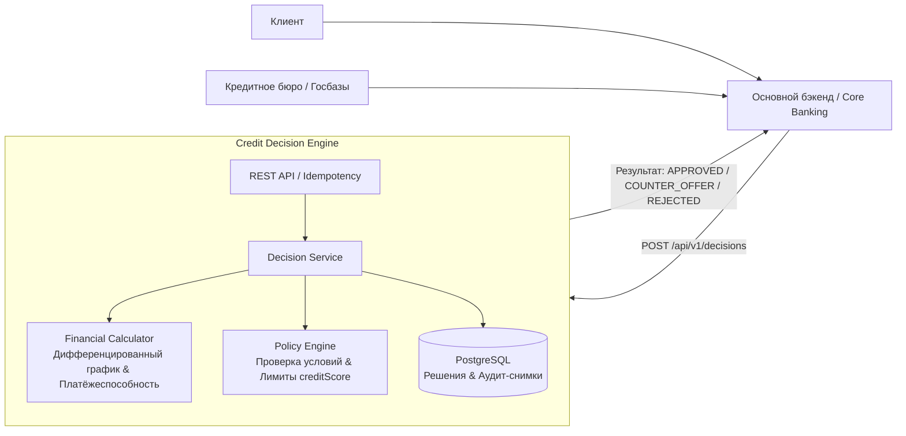

# Credit Decision Platform — технический дизайн

**Версия документа:** 2.0.
**Целевая версия системы:** v1.
**Дата:** 16 октября 2026.

## 1. Назначение документа

Документ определяет архитектуру, границы ответственности, математическую и скоринговую модель, API, схему хранения и эксплуатационные требования сервиса **Credit Decision Engine** (Credit Decision Platform).

Последовательность реализации и критерии готовности приведены в [плане разработки](development-plan.md). Инструкции по локальному запуску и текущему состоянию кода описаны в [README](../README.md).

## 2. Роль сервиса в общей системе и границы продукта

Сервис является **специализированным движком принятия кредитных решений** внутри FinTech-ландшафта. Он не взаимодействует напрямую с конечным клиентом (заёмщиком) и не обращается напрямую в государственные базы данных или внешние кредитные бюро.

Сервис вызывается доверенным **основным бэкендом** (Core Banking / Orchestrator / BFF):
- Основной бэкенд ведёт общий жизненный цикл клиентской заявки, взаимодействует с UI/мобильным приложением, запрашивает кредитные бюро и собирает финансовый профиль клиента.
- Наш сервис принимает нормализованный финансовый профиль, рассчитывает платежи по дифференцированной схеме, вычисляет платёжеспособность, применяет кредитную политику, формирует обоснованное решение (`APPROVED`, `COUNTER_OFFER`, `REJECTED`) и сохраняет полный снимок для аудита и объяснимости.



### Входит в границы v1:
- Приём запроса на принятие кредитного решения от основного бэка через REST API.
- Идемпотентность обработки повторных запросов (`Idempotency-Key` / внешний `requestId`).
- Финансовый калькулятор дифференцированного кредита (равномерное погашение основного долга + начисление процентов на остаток).
- Расчёт максимального ежемесячного платежа (первый платёж графика).
- Оценка платёжеспособности с учётом существующих кредитных обязательств (`existingMonthlyPayments`) и допустимой доли платежей в доходе (DTI).
- Оценка внешнего кредитного рейтинга (`creditScore`, шкала 300–850).
- Принятие решения: одобрение запрошенной суммы (`APPROVED`), встречное предложение меньшей суммы (`COUNTER_OFFER`) или отказ (`REJECTED`) с кодами причин.
- Сохранение неизменяемого снимка входов, версии политики, расшифровки правил и расчётов в PostgreSQL.
- Получение решения по ID и пагинированная история решений.

### Не входит в границы сервиса:
- Прямое общение с заёмщиком, личный кабинет клиента, фронтенд.
- Прямая интеграция с БКИ, KYC, AML, скоринг по соцсетям или выписки из банков.
- Ведение банковских счетов, переводы, выдача денег, проводки, фактическое списание платежей.
- Аннуитетные графики, сложные комиссии, страховые продукты.
- Автоматический подбор изменённых сроков и процентных ставок (при встречном предложении срок и ставка сохраняются).

## 3. Финансовая и скоринговая модель

### 3.1. Входные параметры
Основной бэкенд передаёт следующий финансовый профиль:
1. `requestId` (UUID / String) — уникальный идентификатор запроса/заявки из основной системы.
2. `monthlyIncome` (Decimal > 0) — среднемесячный чистый доход заёмщика (после налогов).
3. `existingMonthlyPayments` (Decimal >= 0) — общая сумма ежемесячных платежей по уже имеющимся кредитам заёмщика (получена основным бэком из БКИ).
4. `creditScore` (Integer, диапазон 300–850) — внешний кредитный балл доверия из бюро.
5. `requestedAmount` (Decimal > 0) — запрошенная сумма кредита.
6. `termMonths` (Integer, 1..60) — срок кредита в месяцах.
7. `nominalAnnualRate` (Decimal, 0.01..1.00) — фиксированная номинальная годовая процентная ставка (например, `0.1800` для 18% годовых).

### 3.2. Дифференцированный график платежей
Кредитный продукт — **дифференцированный потребительский кредит**.
- Месячная ставка: $r = \frac{\text{nominalAnnualRate}}{12}$.
- Погашение основного долга в месяц: $P = \frac{S}{N}$, где $S$ — сумма кредита, $N$ — срок в месяцах (`termMonths`).
- Платёж за месяц $i$ ($i = 1 \dots N$):
  $$\text{Payment}_i = P + S_{\text{rem}, i} \times r$$
  где $S_{\text{rem}, i} = S - (i - 1) \times P$ — остаток основного долга на начало месяца $i$.
- Все платежи убывают со временем. **Максимальный платёж графика — это первый платёж ($i = 1$)**:
  $$\text{MaxMonthlyPayment} = \frac{S}{N} + S \times r = S \times \left(\frac{1}{N} + r\right)$$
- Копейки и округления: расчёты ведутся в `BigDecimal` с банковским округлением (`HALF_EVEN`). Корректировка последнего платежа гарантирует точное закрытие основного долга до нуля.

### 3.3. Расчёт платёжеспособности (DTI)
Политикой фиксируется максимально допустимая совокупная долговая нагрузка ($\text{MaxDTI}$, по умолчанию `0.50` / 50% от дохода).
1. Максимально допустимый совокупный платёж по всем кредитам:
   $$\text{MaxTotalAllowedPayment} = \text{monthlyIncome} \times \text{MaxDTI}$$
2. Доступный бюджет на платёж по новому кредиту:
   $$\text{AvailablePaymentBudget} = \text{MaxTotalAllowedPayment} - \text{existingMonthlyPayments}$$
   Если $\text{AvailablePaymentBudget} \le 0$, заёмщик перегружен долгами $\to$ отказ (`REJECTED`, причина `DTI_LIMIT_EXCEEDED`).
3. Максимальная сумма кредита, допустимая по платёжеспособности ($S_{\text{capacity}}$):
   Так как максимальный платёж кредита равен $S \times \left(\frac{1}{N} + r\right)$, максимальная сумма вычисляется как:
   $$S_{\text{capacity}} = \frac{\text{AvailablePaymentBudget}}{\frac{1}{N} + r}$$
   Сумма округляется вниз до целых единиц валюты (или минимального кредитного шага).

### 3.4. Оценка по внешнему creditScore
Кредитный балл определяет базовую допустимость выдачи и максимальный кредитный лимит:
- Если $\text{creditScore} < \text{MinCreditScore}$ (порог по умолчанию `500`), автоматический отказ (`REJECTED`, причина `LOW_CREDIT_SCORE`).
- Лимит суммы по категориям рейтинга (пример продуктовой шкалы):
  - `750..850` (Excellent): лимит до 10 000 000 KZT.
  - `650..749` (Good): лимит до 6 000 000 KZT.
  - `550..649` (Fair): лимит до 3 000 000 KZT.
  - `500..549` (Poor): лимит до 1 000 000 KZT.
  - `< 500`: 0 KZT (отказ).

### 3.5. Алгоритм принятия итогового решения
1. **Валидация входных данных:** проверка диапазонов, обязательных полей. Ошибки возвращаются как `400 Bad Request`, а не кредитный отказ.
2. **Проверка минимального балла:** если $\text{creditScore} < 500 \to$ `REJECTED`.
3. **Проверка долговой нагрузки:** если $\text{AvailablePaymentBudget} \le 0 \to$ `REJECTED`.
4. **Определение максимально доступной суммы:**
   $$S_{\max} = \min(S_{\text{capacity}}, \text{Limit}(\text{creditScore}), \text{MaxProductAmount})$$
5. **Формирование решения:**
   - Если $S_{\max} < \text{MinProductAmount}$ (например, 50 000 KZT) $\to$ `REJECTED` (причина `CAPACITY_BELOW_MINIMUM`).
   - Если $S_{\max} \ge \text{requestedAmount} \to$ `APPROVED` (одобрена полная запрошенная сумма).
   - Если $S_{\max} < \text{requestedAmount}$ (но $S_{\max} \ge \text{MinProductAmount}$) $\to$ `COUNTER_OFFER` (встречное предложение на сумму $S_{\max}$ при сохранении ставки и срока).

## 4. Архитектура и модули

Приложение реализуется как чистый, модульный сервис на Spring Boot.

```text
kz.alitulegenov.creditdecisionengine
├── controller       # REST контроллеры (v1 и legacy-адаптер)
├── dto              # Запросы, ответы, ошибки
├── service          # Оркестрация принятия решения, валидация, идемпотентность
├── domain / model   # Сущности предметной области (чистые POJO/records)
│   ├── finance      # Калькулятор дифференцированного кредита, графики, DTI
│   └── policy       # Правила, кредитные политики, лимиты, версионирование
├── entity           # JPA-сущности для персистентности (PostgreSQL)
├── repository       # Spring Data JPA репозитории
└── exception        # Доменные и инфраструктурные исключения
```

### Принципы проектирования:
1. **Изоляция финансовых расчётов:** `FinancialCalculator` не зависит от Spring, JPA, HTTP. Это чистая доменная математика, покрытая исчерпывающими unit-тестами.
2. **Версионирование кредитной политики:** правила и лимиты инкапсулируются в версионированные объекты (`CreditPolicy`, например `v1-diff-2026`). Каждое решение сохраняет версию применённой политики.
3. **Идемпотентность:** повторный запрос с тем же `requestId` или заголовком `Idempotency-Key` возвращает ранее рассчитанное решение без повторных вычислений или создания дубликатов.
4. **Объяснимость (Explainability):** в базе сохраняется полный снимок: рассчитанный максимальный платёж, доступный бюджет, DTI, лимит по баллу, итоговая доступная сумма и детализированные коды причин.

## 5. Модель данных и хранилище (PostgreSQL)

Схемой управляет Flyway. Существующие миграции `V1`–`V3` неприкосновенны.

### Новая таблица: `credit_decision_v2` (миграция V4)
- `id` (UUID, PK) — внутренний идентификатор решения.
- `request_id` (VARCHAR(128), UNIQUE, NOT NULL) — идентификатор запроса от основного бэка.
- `idempotency_key` (VARCHAR(128), NULL) — опциональный заголовок идемпотентности.
- `status` (VARCHAR(32), NOT NULL) — `APPROVED`, `COUNTER_OFFER`, `REJECTED`.
- **Входной снимок (Snapshot):**
  - `monthly_income` (NUMERIC(19, 2), NOT NULL)
  - `existing_monthly_payments` (NUMERIC(19, 2), NOT NULL)
  - `credit_score` (INT, NOT NULL)
  - `requested_amount` (NUMERIC(19, 2), NOT NULL)
  - `term_months` (INT, NOT NULL)
  - `nominal_annual_rate` (NUMERIC(7, 4), NOT NULL)
- **Расчётные показатели:**
  - `max_monthly_payment` (NUMERIC(19, 2), NULL) — первый платёж по графику
  - `available_payment_budget` (NUMERIC(19, 2), NULL)
  - `calculated_dti` (NUMERIC(5, 4), NULL)
  - `approved_amount` (NUMERIC(19, 2), NULL) — итоговая одобренная/предложенная сумма
- **Политика и объяснение:**
  - `policy_version` (VARCHAR(64), NOT NULL)
  - `decision_reasons` (JSONB / TEXT[], NOT NULL) — коды причин (например, `["APPROVED_FULL_AMOUNT"]` или `["INSUFFICIENT_INCOME_CAPACITY"]`)
- **Служебные поля:**
  - `created_at` (TIMESTAMPTZ, NOT NULL)

## 6. Контракт REST API v1

### POST `/api/v1/decisions`
Запрос от основного бэкенда:
```json
{
  "requestId": "9c8661a7-bfca-4e92-a5d6-e83946092775",
  "monthlyIncome": 500000.00,
  "existingMonthlyPayments": 100000.00,
  "creditScore": 720,
  "requestedAmount": 3000000.00,
  "termMonths": 24,
  "nominalAnnualRate": 0.1800
}
```

Ответ при полном одобрении (`200 OK`):
```json
{
  "decisionId": "a1b2c3d4-e5f6-7890-abcd-ef1234567890",
  "requestId": "9c8661a7-bfca-4e92-a5d6-e83946092775",
  "status": "APPROVED",
  "approvedAmount": 3000000.00,
  "termMonths": 24,
  "nominalAnnualRate": 0.1800,
  "maxMonthlyPayment": 170000.00,
  "policyVersion": "v1-diff-2026",
  "reasons": ["APPROVED_FULL_AMOUNT"],
  "createdAt": "2026-10-16T15:30:00Z"
}
```

Ответ при встречном предложении (`COUNTER_OFFER`, `200 OK`):
```json
{
  "decisionId": "b2c3d4e5-f6a7-8901-bcde-f12345678901",
  "requestId": "9c8661a7-bfca-4e92-a5d6-e83946092776",
  "status": "COUNTER_OFFER",
  "approvedAmount": 2150000.00,
  "termMonths": 24,
  "nominalAnnualRate": 0.1800,
  "maxMonthlyPayment": 121833.33,
  "policyVersion": "v1-diff-2026",
  "reasons": ["INSUFFICIENT_INCOME_CAPACITY"],
  "createdAt": "2026-10-16T15:30:00Z"
}
```

Ответ при отказе (`REJECTED`, `200 OK`):
```json
{
  "decisionId": "c3d4e5f6-a7b8-9012-cdef-123456789012",
  "requestId": "9c8661a7-bfca-4e92-a5d6-e83946092777",
  "status": "REJECTED",
  "approvedAmount": null,
  "termMonths": 24,
  "nominalAnnualRate": 0.1800,
  "maxMonthlyPayment": null,
  "policyVersion": "v1-diff-2026",
  "reasons": ["LOW_CREDIT_SCORE", "DTI_LIMIT_EXCEEDED"],
  "createdAt": "2026-10-16T15:30:00Z"
}
```

### GET `/api/v1/decisions/{id}`
Получение детального решения по UUID (включая расчётные метрики и снимок).

### GET `/api/v1/decisions`
Пагинированный список принятых решений (`page`, `size`, сортировка `createdAt DESC, id DESC`).

## 7. Стратегия тестирования и надёжность

1. **Unit-тесты чистой логики (без Spring):**
   - Точность дифференцированного калькулятора, округление, проверка последнего платежа.
   - Корректность вычисления бюджета платежа и максимальной суммы займа.
   - Граничные условия шкалы `creditScore` и порогов DTI.
2. **Интеграционные тесты (Spring Boot + Testcontainers PostgreSQL 16):**
   - Проверка полной цепочки от HTTP контроллера до сохранения в PostgreSQL.
   - Идемпотентность: параллельные запросы с одним `requestId` дают ровно одну запись.
   - Применение миграций Flyway поверх `V1`–`V3`.
   - Валидация входных данных (`@Valid`, `MethodArgumentNotValidException`).
